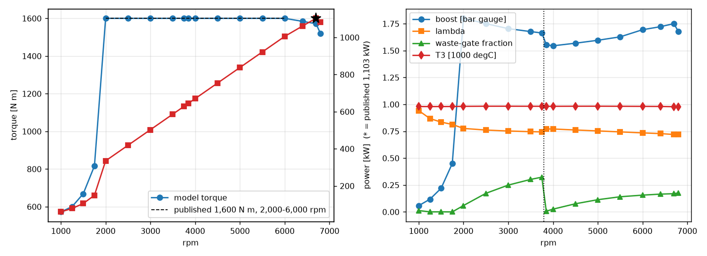
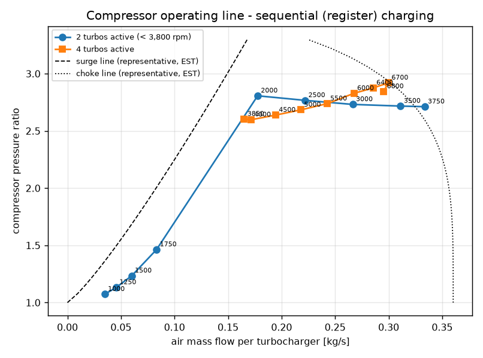
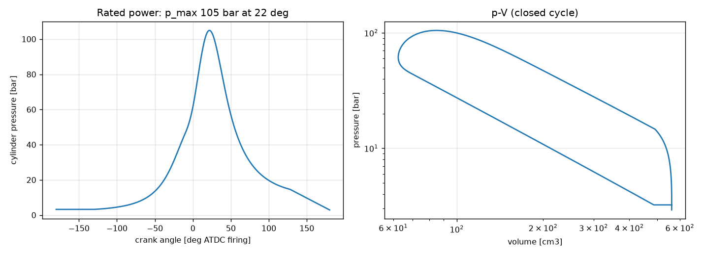

# Performance and turbocharger matching (0-D cycle model)

Generated by `python -m w16.reports`. Model: single-zone closed cycle (Wiebe heat release, Woschni heat transfer
x 2.0, Chen-Flynn friction), rectangular pumping loop, turbocharger power balance with a fixed
turbine flow area and a waste-gate. It is a **sizing model, not a calibrated simulation**.

## Assumptions (all EST unless tagged)

| constant | value |
|---|---|
| R_air | 287 |
| cp_air | 1005 |
| gam_air | 1.4 |
| cp_exh | 1250 |
| gam_exh | 1.3 |
| R_exh | 290 |
| LHV | 4.25e+07 |
| AFR_st | 14.2 |
| wiebe_a | 6.908 |
| wiebe_m | 2 |
| ivc_deg | -130 |
| evo_deg | 128 |
| T_wall_head | 500 |
| T_wall_piston | 560 |
| T_wall_liner | 420 |
| resid_frac | 0.04 |
| T_resid | 950 |
| dT_charge_heating | 18 |
| h_fg_fuel | 3.5e+05 |
| evap_frac_port | 0.5 |
| eta_comp | 0.72 |
| eta_turb | 0.68 |
| eta_mech | 0.97 |
| ic_effectiveness | 0.86 |
| T_lt_coolant | 313 |
| dp_filter_rated | 2500 |
| dp_cac_rated | 1.2e+04 |
| dp_throttle | 1500 |
| dp_exh_rated | 3.2e+04 |
| mdot_rated_ref | 1.22 |
| T3_limit | 1253 |
| lam_min | 0.72 |
| lam_max_fullload | 0.95 |
| exh_manifold_heat_loss | 0.06 |
| woschni_scale | 2 |

Volumetric efficiency, CA50 and burn duration are speed tables in `src/w16/analysis/cycle.py`.
The torque target is the published curve (1,600 N m from 2,000 to 6,000 rpm, 1,103 kW at 6,700 rpm); the model
solves the manifold pressure needed to reach it and reports whether the turbochargers can supply it.

## Full-load results

| rpm | torque | power_kw | bmep_bar | boost_bar | pr_comp | T2_c | T_man_c | mdot_air | lam | bsfc_g_kwh | p_max_bar | T3_c | p3_bar | er_turb | wg_frac | n_active | turbine-limited |
|---|---|---|---|---|---|---|---|---|---|---|---|---|---|---|---|---|---|
| 1000 | 572.4 | 59.94 | 9 | 0.05801 | 1.073 | 33.43 | 33.43 | 0.06974 | 0.9425 | 312.9 | 30.58 | 980.2 | 1.049 | 1.034 | 0.01265 | 2 | yes |
| 1250 | 600.1 | 78.55 | 9.435 | 0.1179 | 1.133 | 40.02 | 39.87 | 0.09123 | 0.8682 | 339.1 | 32.46 | 979.6 | 1.077 | 1.061 | 0.0003712 | 2 | yes |
| 1500 | 668.9 | 105.1 | 10.52 | 0.2195 | 1.234 | 50.66 | 41.36 | 0.1201 | 0.8352 | 346.9 | 36.34 | 980 | 1.125 | 1.106 | 0.0007406 | 2 | yes |
| 1750 | 816.4 | 149.6 | 12.83 | 0.4501 | 1.464 | 72.61 | 44.44 | 0.1666 | 0.8137 | 346.9 | 44.24 | 980.4 | 1.232 | 1.207 | 0 | 2 | yes |
| 2000 | 1600 | 335.2 | 25.16 | 1.8 | 2.807 | 167 | 57.65 | 0.3553 | 0.7765 | 346.1 | 84.61 | 981.8 | 1.954 | 1.869 | 0.05919 | 2 |  |
| 2500 | 1600 | 419 | 25.16 | 1.751 | 2.767 | 164.7 | 57.34 | 0.4441 | 0.7613 | 353 | 87.59 | 982.8 | 2.152 | 2.023 | 0.1728 | 2 |  |
| 3000 | 1600 | 502.7 | 25.16 | 1.704 | 2.731 | 162.7 | 57.05 | 0.5329 | 0.7524 | 357.2 | 90.86 | 982.9 | 2.346 | 2.16 | 0.2494 | 2 |  |
| 3500 | 1600 | 586.5 | 25.16 | 1.677 | 2.717 | 161.9 | 56.93 | 0.6223 | 0.7462 | 360.4 | 94.41 | 982.4 | 2.548 | 2.29 | 0.3022 | 2 |  |
| 3750 | 1600 | 628.4 | 25.16 | 1.664 | 2.712 | 161.6 | 56.89 | 0.6672 | 0.7441 | 361.7 | 96.3 | 982.3 | 2.651 | 2.35 | 0.3231 | 2 |  |
| 3850 | 1600 | 645.2 | 25.16 | 1.555 | 2.603 | 155.2 | 56 | 0.6603 | 0.7712 | 336.4 | 94.44 | 982.1 | 1.925 | 1.711 | 0.00669 | 4 |  |
| 4000 | 1600 | 670.3 | 25.16 | 1.545 | 2.597 | 154.8 | 55.95 | 0.6855 | 0.7711 | 336.2 | 95.49 | 982.1 | 1.959 | 1.728 | 0.02566 | 4 |  |
| 4500 | 1600 | 754.1 | 25.16 | 1.569 | 2.638 | 157.3 | 56.29 | 0.7777 | 0.7618 | 343.2 | 97.24 | 982.7 | 2.106 | 1.802 | 0.07563 | 4 |  |
| 5000 | 1600 | 837.9 | 25.16 | 1.596 | 2.684 | 160 | 56.67 | 0.8722 | 0.7533 | 350.3 | 99.13 | 982.9 | 2.267 | 1.876 | 0.1135 | 4 |  |
| 5500 | 1600 | 921.7 | 25.16 | 1.628 | 2.738 | 163.1 | 57.1 | 0.9699 | 0.7442 | 358.4 | 101.2 | 982.3 | 2.445 | 1.947 | 0.1409 | 4 |  |
| 6000 | 1600 | 1005 | 25.16 | 1.694 | 2.828 | 168.2 | 57.82 | 1.07 | 0.7349 | 367.3 | 103.3 | 981.6 | 2.653 | 2.027 | 0.156 | 4 |  |
| 6400 | 1584 | 1062 | 24.91 | 1.723 | 2.876 | 170.9 | 58.19 | 1.142 | 0.7282 | 374.5 | 104.2 | 980.9 | 2.801 | 2.074 | 0.1654 | 4 |  |
| 6700 | 1572 | 1103 | 24.71 | 1.751 | 2.92 | 173.3 | 58.54 | 1.199 | 0.72 | 382.7 | 104.9 | 978.1 | 2.926 | 2.112 | 0.1693 | 4 |  |
| 6800 | 1519 | 1082 | 23.89 | 1.679 | 2.845 | 169.1 | 57.95 | 1.181 | 0.72 | 384.5 | 101.9 | 978.2 | 2.858 | 2.079 | 0.1768 | 4 |  |

## Comparison with published figures

| quantity | model | reference | source | deviation |
|---|---|---|---|---|
| Rated power [kW] | 1103 | 1103 | PUB | -0.0 % |
| Torque on plateau, min [N m] | 1600 | 1600 | PUB | +0.0 % |
| Air flow at rated [L/min, ISO ambient] | 6.074e+04 | 6e+04 | PUB (>60,000) | +1.2 % |
| Charge-air temperature drop at rated [K] | 114.8 | 130 | PUB (as much as 130) | -11.7 % |
| Power-equivalent air supply per turbo [PS] | 374.8 | 380 | PUB (approx. 380) | -1.4 % |
| Turbine inlet temperature at rated [degC] | 978.1 | 980 | PUB valve rating (limit) | -0.2 % |

Notes
- Rated power and plateau torque are *targets*; the informative results are the boost, air flow, temperatures and
  the fact that the turbocharger balance closes.
- Rated-power boost: **1.75 bar gauge** (2.76 bar abs). Secondary sources quote about
  1.85 bar for the Chiron; no manufacturer figure was found.
- The turbine-inlet limit (980 degC, the published rating of the exhaust switching valve) is held by
  enrichment; the model needs lambda = 0.72 at rated power, i.e. BSFC 383 g/kWh and
  567 L/h of fuel. This is consistent in magnitude with the widely quoted statement that
  a 100 L tank lasts roughly nine minutes at full load, but the enrichment level is a model result, not a measured value.
- Below 2000 rpm the torque is limited by turbine power (waste-gates shut).

## Sequential turbocharging - sizing logic

- Turbine effective flow area per turbocharger: **8.43 cm2** (CALC). Binding design point: just above the
  change-over (3800 rpm, four turbochargers) the flow per turbine is at its minimum for full torque, so the
  waste-gates must be just closed there. With two turbochargers the same flow per turbine occurs near half that speed,
  which is why full torque is available from about 2,000 rpm - the published torque plateau and change-over speed are
  mutually consistent with four equal-size turbochargers.
- Provisional compressor: design flow 0.334 kg/s per turbocharger at PR 2.92;
  tip speed 468 m/s; impeller exducer **83 mm**, inducer 60 mm; speed
  108118 rpm; shaft power 46 kW. Turbine wheel 76 mm inducer /
  65 mm exducer (EST ratios). These are sizing values, not an aerodynamic design.

The surge and choke lines are representative shapes for a compressor of this size, drawn only to show why two
turbochargers must carry the engine at low speed (with four in parallel the low-speed points would lie left of the
surge line). They are **not** a measured map.

## Control strategy derived from the model

| Regime | Active turbos | Boost control | Protection |
|---|---|---|---|
| < ~2,000 rpm | 2 (A-turbos) | waste-gates shut, exhaust valves to B-turbines shut, B-compressors isolated by check valves | spark retard on knock (ion current) |
| 2,000 - 3,800 rpm | 2 | waste-gate closed-loop on manifold pressure (bypass 17-32 %) | compressor outlet temperature, turbo speed model |
| ~3,600 - 3,800 rpm | 2 -> 4 | B-turbine valves opened progressively to pre-spin B-turbos; B-compressor recirculation open until its outlet pressure reaches manifold pressure, then check valve opens | surge margin of the B-compressors, torque smoothing by spark/throttle |
| > 3,800 rpm | 4 | all waste-gates closed-loop (bypass 1-17 %) | T3 <= 980 degC by enrichment, over-speed limit, boost reduction on knock/misfire |

