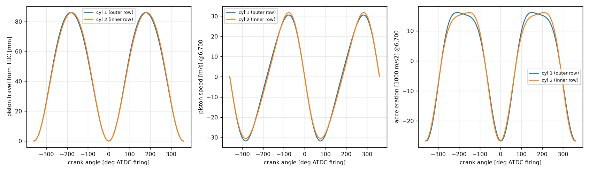
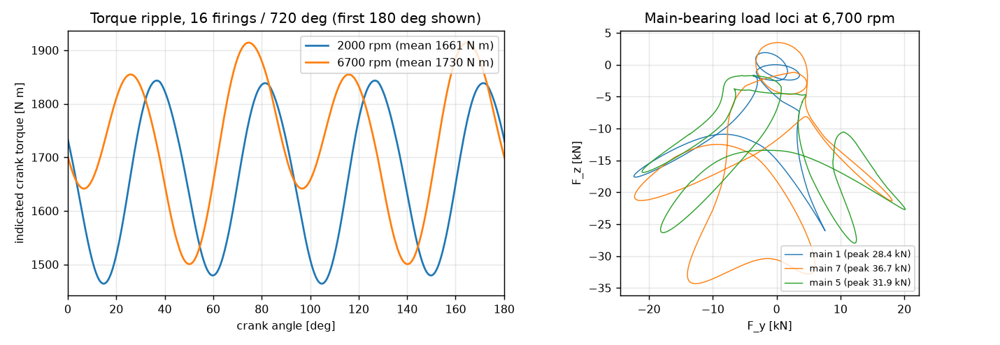

# Crank-train kinematics, balance, bearing loads and torsional vibration

Generated by `python -m w16.reports`. Rigid-body model; bearing loads from a statically determinate bay model
(each throw carried by its two neighbouring main bearings).

## Geometry (CALC from the master parameters)

| Item | Value |
|---|---|
| Stroke / crank throw | 86.000 mm / 42.8680 mm (offset bores: stroke > 2r) |
| Rod length / ratio r/l | 164.0 mm / 0.2614 |
| Row offset | 12.5 mm |
| Max rod angularity | 19.69 deg |
| Mean / max piston speed at 6700 rpm | 19.21 / 31.79 m/s |
| Piston acceleration at TDC / BDC at 6700 rpm | -26685 / 16091 m/s2 |
| Same at mechanical overspeed 7300 rpm | -31679 / 19102 m/s2 |
| Firing intervals (numerically located TDCs) | min 45.000 deg, max 45.000 deg |
| Crankpin phases, pins 1-8 | 55.93, 259.07, 145.93, 169.07, 325.93, 349.07, 235.93, 79.07 deg |

Masses used (EST until replaced by CAD mass properties): piston 0.446 kg, pin 0.141 kg, rings 0.027 kg,
rod 0.43 kg (CG at 30% of the length from the big end) -> reciprocating 0.743 kg per cylinder,
rotating rod mass 0.301 kg.

## Balance

Each crankpin carries one cylinder of each bank, 90 deg apart, so the first-order reciprocating forces of a pair form
a vector rotating with the crank; it is cancelled together with the rotating rod mass by the counterweights of that
throw. Because of the VR offsets the required counterweight vector is not exactly opposite the pin; it was solved
per throw:

| Throw | 1 | 2 | 3 | 4 | 5 | 6 | 7 | 8 |
|---|---|---|---|---|---|---|---|---|
| m*r required [kg mm] | 57.71 | 57.71 | 57.71 | 57.71 | 57.71 | 57.71 | 57.71 | 57.71 |
| angle from pin [deg] | 177.54 | -177.54 | 177.54 | -177.54 | 177.54 | -177.54 | 177.54 | -177.54 |

(the crankpin's own unbalance is added in CAD.) Residual free forces and moments at 6700 rpm:

| Quantity | Peak | Dominant orders (amplitude) |
|---|---|---|
| Free force | 206 N | 4th: 206 N vertical, 111 N lateral |
| Free moment | 39 N m | 1st: 0.0; 3rd: 10.9; 4th: 29.7 N m (pitch) |

For scale: the unbalanced reciprocating force of a single cylinder at this speed is 15.7 kN.
The W16 with this crank is therefore free of first- and second-order forces and moments; only small higher-order
residuals remain. No balance shafts are needed (the VW W8 needs two, the W12 and W16 none).

## Loads (full load)

| rpm | rod compression [kN] | rod tension [kN] | piston side force [kN] | big-end bearing [kN] | big-end spec. load [MPa] | main bearing peak [kN] | main spec. load [MPa] | small-end spec. load [MPa] | mean torque [N m] | max torque | min torque |
|---|---|---|---|---|---|---|---|---|---|---|---|
| 2000 | 48.22 | -1.128 | 10.22 | 47.79 | 52.52 | 34.71 | 31.9 | 100.5 | 1661 | 1843 | 1464 |
| 3000 | 49.86 | -3.113 | 10.04 | 48.84 | 53.67 | 35.07 | 32.24 | 103.9 | 1679 | 1849 | 1505 |
| 3750 | 50.92 | -5.178 | 9.85 | 49.28 | 54.15 | 35.38 | 32.52 | 106.1 | 1694 | 1865 | 1515 |
| 5000 | 48.09 | -10.24 | 9.006 | 45.11 | 49.58 | 35.54 | 32.66 | 100.2 | 1722 | 1897 | 1529 |
| 6000 | 46.03 | -14.89 | 8.444 | 41.72 | 45.84 | 36.6 | 33.64 | 95.89 | 1743 | 1924 | 1530 |
| 6700 | 43.34 | -18.76 | 7.814 | 37.86 | 41.6 | 36.72 | 33.75 | 90.3 | 1730 | 1914 | 1501 |

- Mean indicated torque from the force model vs. cycle model at 6,700 rpm: 1730 vs 1762 N m
  (-1.8 %, consistency check between two independent calculations).
- Rod tension at gas-exchange TDC, overspeed 7300 rpm, no gas load: **23.5 kN**.
- Design gas force at the design peak pressure 135 bar: **78.4 kN** (used for the FE load cases).
- Bearing projected widths used: big end 16.25 mm x dia 56.0 mm; main 16.0 mm x dia 68.0 mm.
  Typical capability of sputter (AlSn20 on bronze) bearings: 100+ MPa; bimetal: ~60 MPa. Both journals are inside this.
- Quasi-static short-bearing (Ocvirk) minimum film at peak load: big end 0.76 um (2,000 rpm), main 1.71 um
  (6,700 rpm). This estimate ignores squeeze-film support and is conservative; an elasto-hydrodynamic orbit
  calculation is required before release (listed under limitations).

## Torsional vibration (lumped model: damper - 8 throws - flywheel)

Throw stiffness from Carter's formula: 789 kN m/rad; throw inertia 6.67 g m2 (EST until CAD);
damper 22 g m2; flywheel side 110 g m2.

Natural frequencies: 302 Hz, 800 Hz, 1353 Hz, 1901 Hz.
First mode (302 Hz) is excited by order 8 at 2265 rpm, order 4 at 4530 rpm and
order 2.5 at 7248 rpm.

| rpm | vibratory torque, worst section [N m, RSS of orders] | largest single order | its amplitude [N m] |
|---|---|---|---|
| 2000 | 922.3 | 0.5 | 704.8 |
| 3000 | 982.4 | 0.5 | 725.1 |
| 3750 | 1085 | 0.5 | 740.4 |
| 5000 | 1125 | 0.5 | 741.5 |
| 6000 | 1247 | 0.5 | 760.8 |
| 6700 | 1253 | 2.5 | 883.5 |

Nominal torsional shear stress in the crankpin (dia 56.0 mm) for mean + vibratory torque at 6,700 rpm:
86 MPa (before stress concentration).
A viscous damper is required at the free end; its tuning needs measured crank stiffness - listed under limitations.
