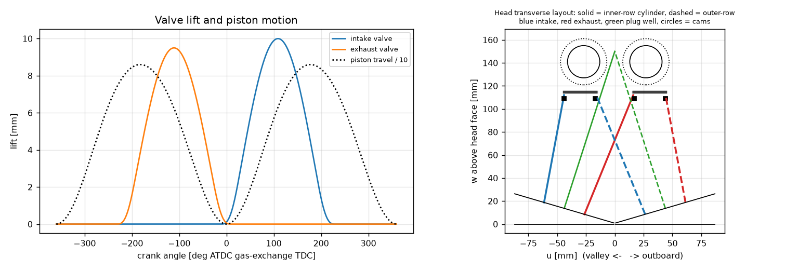

# Valve train - layout, timing, clearances, spring loads

Generated by `python -m w16.reports`. Architecture per decision D-020 (two camshafts per head, roller finger followers
on hydraulic support elements, short and long valves). Dimensions are an engineering proposal (EST).

## Transverse layout (head-local u, w in mm)

| row | valve | head u | head w | tip u | tip w | stem tilt [deg] | head-to-tip length | support element u | cam u |
|---|---|---|---|---|---|---|---|---|---|
| inner | in | -61.34 | 18.8 | -44 | 112 | 10.54 | 94.8 | -17 | -27 |
| inner | ex | -26.34 | 8.503 | 16 | 112 | 22.25 | 111.8 | 44 | 27 |
| outer | in | 26.34 | 8.503 | -16 | 112 | -22.25 | 111.8 | -44 | -27 |
| outer | ex | 61.34 | 18.8 | 44 | 112 | -10.54 | 94.8 | 17 | 27 |

- Camshafts at u = -/+27 mm, w = 141 mm; base circle radius 14 mm.
- Two finger types (D-034): short valves 17 mm tip arm / 10 mm pivot arm, ratio 2.70
  (cam lift 3.70 mm for 10.0 mm valve lift); long valves 11 / 17 mm,
  ratio 1.65 (cam lift 6.07 mm). The short pivot arm puts the short valve's support element
  17 mm from the head centre plane, clear of the long valve's spring; that element's boss hangs from the plug tower
  (lower end w = 82 mm). A ratio of 2.7 is high for a finger follower: finger stiffness and roller contact
  stress must be checked in detail design.
- Valve springs: beehive, 20 mm largest coil, installed height 38 mm (seat 42 mm below the tip).
- Each camshaft serves the nearer row with short valves (95 mm head-to-tip, 10.5 deg) and the farther row with
  long valves (112 mm, 22.3 deg).
- Chamber roof tilt 16.40 deg; piston crown tilted 8.51 deg to the head face (16.01 deg to the piston
  axis normal) to give CR 9.0:1 with an analytic head-chamber volume of 87.4 cm3 (clearance volume
  62.44 cm3). The CAD-measured compression ratio is reported in the CAD validation.
- Spark-plug wells tilt 17.8 deg and meet the head centre plane at w = 150 mm: one row of eight coils per head.

### Clearance study (transverse plane, positive = clear)

| check | margin [mm] |
|---|---|
| inner row: plug well vs in valve spring (min wall, mm) | 9.407 |
| inner row: plug well vs in valve guide boss (min wall, mm) | 7.962 |
| inner row: plug well vs ex valve spring (min wall, mm) | 8.486 |
| inner row: plug well vs ex valve guide boss (min wall, mm) | 8.949 |
| inner row: plug well vs intake cam core (clearance, mm) | 0.9487 |
| inner row: plug well vs exhaust cam core (clearance, mm) | 6.459 |
| outer row: plug well vs in valve spring (min wall, mm) | 8.486 |
| outer row: plug well vs in valve guide boss (min wall, mm) | 8.949 |
| outer row: plug well vs ex valve spring (min wall, mm) | 9.407 |
| outer row: plug well vs ex valve guide boss (min wall, mm) | 7.962 |
| outer row: plug well vs intake cam core (clearance, mm) | 6.459 |
| outer row: plug well vs exhaust cam core (clearance, mm) | 0.9487 |
| cam lobe tip circle to opposite cam lobe tip circle (mm) | 13.86 |
| inner row: intake finger vs exhaust finger lateral gap (mm) | 21 |
| outer row: intake finger vs exhaust finger lateral gap (mm) | 21 |
| inner row: long ex valve spring vs short in valve support-element boss (mm) | 1.184 |
| inner row: long ex valve spring vs short in valve support element (mm) | 3.941 |
| inner row: long ex valve stem vs short in valve support-element boss (mm) | 8.193 |
| inner row: plug well vs short in valve support-element bore (wall, mm) | 3.501 |
| outer row: long in valve spring vs short ex valve support-element boss (mm) | 1.184 |
| outer row: long in valve spring vs short ex valve support element (mm) | 3.941 |
| outer row: long in valve stem vs short ex valve support-element boss (mm) | 8.193 |
| outer row: plug well vs short ex valve support-element bore (wall, mm) | 3.501 |

## Timing (EST, phaser mid-position)

| Event | Crank angle |
|---|---|
| IVO | 12 deg BTDC |
| IVC | 50 deg ABDC |
| EVO | 52 deg BBDC |
| EVC | 10 deg ATDC |
| Overlap | 22 deg |
| Intake / exhaust duration | 242 / 242 deg |
| Phaser authority (VW W-family values) | intake 52 deg, exhaust 22 deg crank |

Lift law: half-sine acceleration flanks (17% of the event each) with a half-sine nose. Inlet Mach index at
6700 rpm: Z = 0.51 (should stay below about 0.6).

## Piston-to-valve clearance (minimum over the cycle, tilted crown included)

| row | valve | min clearance [mm] | at crank angle [deg] | valve lift there [mm] |
|---|---|---|---|---|
| inner | in | 10.82 | 2.5 | 0.1975 |
| inner | ex | 5.371 | -1.5 | 0.09315 |
| outer | in | 4.702 | 2 | 0.1786 |
| outer | ex | 10.99 | -1.5 | 0.09315 |

Criterion used: >= 1.5 mm intake, >= 2.0 mm exhaust. Shallow valve pockets are added in the piston CAD for the
far-side valves to raise the smallest values.

## Spring requirement at mechanical overspeed (7300 rpm)

| valve | effective mass [g] | nose decel. [m/s2] | flank accel. [m/s2] | inertia force at nose [N] | required (x1.25) [N] | seat load [N] | rate [N/mm] | load at full lift [N] | max valve speed [m/s] |
|---|---|---|---|---|---|---|---|---|---|
| intake | 90.67 | -5284 | 1.026e+04 | 479.1 | 598.9 | 270 | 32.89 | 598.9 | 6.134 |
| exhaust | 86.67 | -5020 | 9745 | 435.1 | 543.8 | 293.1 | 26.4 | 543.8 | 5.827 |

Effective masses are EST (valve, retainer, one third of the spring, follower equivalent). No valve-train
dynamic (multi-body) simulation was run; spring surge is not assessed.

