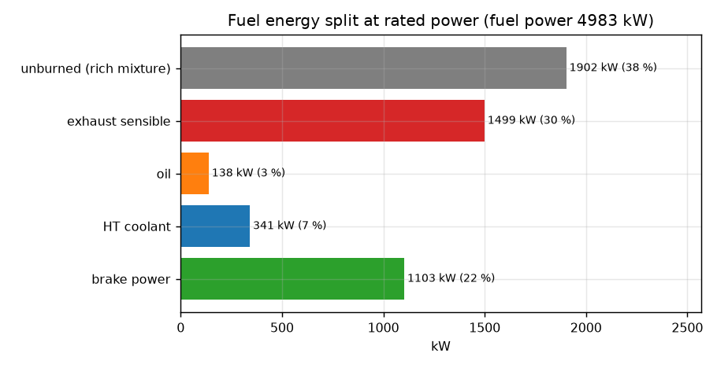

# Thermal management, charge-air cooling, lubrication, fuel and duct sizing

Generated by `python -m w16.reports`. Analytical / 1-D steady-state calculations at rated power
(6700 rpm, 1103 kW) unless stated. Not CFD.

## Energy balance at rated power

| item | kW | share |
|---|---|---|
| Fuel power | 4983 | 100.0 % |
| Brake power | 1103 | 22.1 % |
| Heat to HT coolant | 341.1 | 6.8 % |
| Heat to oil | 138 | 2.8 % |
| Exhaust sensible enthalpy (after turbine) + radiation | 1499 | 30.1 % |
| Unburned chemical energy (enrichment) | 1902 | 38.2 % |

Charge-air heat rejected to the LT circuit: 138 kW (this is compressor work, recirculated inside the balance).
Total heat leaving the engine other than shaft power: 5275 PS equivalent, of which
2689 PS is sensible heat. Published statement: "more than 3,000 hp" of heat.

In-cylinder wall heat (Woschni x 2.0): head 107 kW, piston 96 kW, liner 83 kW.
Split assumptions (EST): 55 % of piston heat and 55 % of friction heat to oil; 60 % of exhaust-port heat to coolant.

## High-temperature coolant circuit

| Item | Value |
|---|---|
| Pump flow (PUB) | 800 L/min = 13.7 kg/s |
| Coolant temperature rise across the engine | 6.9 K |
| Circulation time of the 37 L fill (PUB: about 3 s) | 2.8 s |
| Mean jacket velocity / Reynolds number | 3.1 m/s / 58689 |
| Jacket heat-transfer coefficient (Dittus-Boelter) | 9483 W/m2K |
| Liner top zone heat flux | 0.52 MW/m2 |
| Liner wall temperature, coolant side / gas side | 150 / 167 degC |
| Fire-deck heat flux | 1.00 MW/m2 |
| Fire-deck temperature, coolant side / gas side (mean, 1-D) | 169 / 229 degC |

Coolant-side wall temperatures above about 130 degC imply sub-cooled nucleate boiling at 1.4-2 bar system pressure,
which is normal in exhaust-side head passages. Local hot spots (exhaust valve bridge) are assessed by FE in
`08_SIMULATIONS/fea/`.

### Flow distribution (1-D ladder network, one bank)

Inlet rail and outlet rail dia 46 mm, eight cylinder branches (jacket + gasket metering + head passages, K = 9.0).
Flow per cylinder station [L/min]: 50.1, 50.0, 50.0, 50.0, 50.0, 50.0, 50.0, 50.1 -> maldistribution 0.21 %.
Engine pressure drop 1.05 bar, circuit total 1.95 bar (external 0.9 bar EST) -> pump hydraulic power
2.6 kW, shaft power 4.2 kW at 62 % efficiency.

## Charge-air cooler (water-to-air, one per bank)

Core (EST): 420 x 130 mm face, 180 mm deep, 15 layers,
fin pitch 1.6 mm, fin height 6 mm. LT coolant 240 L/min total at 40 degC.

| Item | Value |
|---|---|
| Air flow per cooler | 0.599 kg/s |
| Air in / out | 173 / 53 degC |
| Temperature drop (PUB: "as much as 130 K") | 120 K |
| Effectiveness (e-NTU, cross-flow) / NTU | 0.902 / 2.53 |
| Heat rejected, both coolers | 146 kW |
| Air-side pressure drop of the core | 0.46 kPa |
| LT coolant temperature rise | 10.0 K |
| Air-side / water-side h | 279 / 1500 W/m2K |

The cycle model uses a deliberately lower effectiveness of 0.86 (fouling, maldistribution, hot LT coolant).

## Lubrication (dry sump)

| Consumer | Flow [L/min] at 5 bar gallery pressure, hot |
|---|---|
| 9 main bearings | 7.7 |
| 16 big-end bearings | 7.0 |
| 16 piston cooling jets (dia 2.2 mm) | 98.8 |
| 20 camshaft bearings | 1.1 |
| 64 hydraulic elements + finger spray | 7.2 |
| 4 cam phasers | 4.8 |
| 4 turbochargers | 7.2 |
| chain tensioners + chain spray | 4.4 |
| **Total engine demand** | **140** |
| Pressure pump delivery (x1.25) | 175 |
| Scavenge capacity (x3, aerated) | 524 |

Oil heat load 138 kW -> oil temperature rise 34 K. Two main galleries dia 18 mm
(required 18.4 mm for 3.5 m/s) -> 3.7 m/s. Tank volume >= 35 L (12 s dwell).
Pump drive power about 4.2 kW. Bearing flows use the pressure-fed side-leakage formula at an
eccentricity ratio of 0.6 and are approximate.

## Fuel system (duplex port injection, 32 injectors)

Fuel flow at rated power 117 g/s = 567 L/h (lambda 0.72); per cylinder 7.33 g/s.
Two injectors per cylinder at 85% duty -> static flow 347 cm3/min each; selected size
375 cm3/min at 5 bar differential. Supply pumps 765 L/h (x1.35).

## Duct sizing (velocity / Mach limits, EST)

| item | value [mm unless named] |
|---|---|
| exh_primary_id | 43.48 |
| exh_collector_id | 63.51 |
| turbine_inlet_id | 58.63 |
| T4_c | 843.3 |
| downpipe_id | 101.5 |
| main_exhaust_id | 139.9 |
| comp_inlet_id | 65.55 |
| comp_inlet_id_2turbo | 61.45 |
| charge_pipe_id | 60.6 |
| throttle_id | 66.18 |
| runner_id | 47.87 |
| plenum_volume_l_per_bank | 3.597 |

## Charge-air distribution

A quasi-steady 1-D model of an **end-fed log plenum** (rejected concept) gives relative runner flows of
0.56, 0.70, 0.85, 0.98, 1.10, 1.20, 1.28, 1.32 along the bank, a spread of 77 %, because the dynamic head in a
slim plenum exceeds the runner loss. Design consequence (decision D-021): the water-to-air cooler sits directly on
the plenum and discharges into it over its full length, so the plenum sees no axial through-flow; distribution is
then governed by the cooler inlet tank. That flow is three-dimensional and was **not** simulated (no CFD available).
