# W16 engine reconstruction - engineering design report

**Subject:** 8.0-litre, quad-turbocharged W16 reconstructed from publicly documented information on the Bugatti Chiron engine.
**Status:** concept-level digital engineering package (analysis + parametric CAD + linear FE). Not manufacturer data, not released for manufacture.
**Open item - piston:** **hot fatigue NOT ASSESSABLE with available public data** (the method fails even production-range temperatures: with Woschni x 1.0 the crown runs at 272 degC, inside the 270-310 degC range of production gasoline pistons, and the factors are still 0.23-0.51); crown 376 degC (heat-consistent, Woschni x 2.0) is above the typical 270-310 degC range - **OPEN: cooling upgrade + hot-strength piston alloy with manufacturer data**. With 4032-T6 lower-bound strength (10,000 h at temperature) the factors are 0.10-0.28; neither they nor the room-temperature factor 2.05 are acceptance measures (sections 8.1, 8.2).
**Date:** 2026-11-14. **Generated by:** `python -m w16.docs` from the evidence files in this repository.

## 1. Project overview

The package reconstructs the architecture of the W16 from public sources and fills every gap with a labelled engineering
value. Each number carries a tag: PUB (published), SEC (secondary source), CALC (calculated here), EST (engineering estimate).
What exists:

| Deliverable | Content |
|---|---|
| Research + reference specification | sources with confidence levels, firing-order consistency proof, parameter table |
| Analytical models | 0-D cycle and turbo matching, crank-train dynamics and balance, valve train, thermal / lubrication / fuel sizing |
| Parametric CAD | 151 part numbers, 1597 placed parts, 15 sub-assemblies, generated from one parameter file |
| Checks | CAD compression ratio, interference (static + 12 crank angles), mass and envelope |
| FE | 6 linear structural / thermal cases on the CAD solids |
| Outputs | STEP / BREP / STL / 3MF, drawings, renders, exploded and section views, animations, BOM, manufacturing specification |


<p><br><em>Dressed engine, isometric view from the free end (CAD render).</em></p>


## 2. Reference specifications

| Item | Value | Tag |
|---|---|---|
| Configuration | W16: two VR8 banks at 90 deg, each with two rows at 15 deg; one crankshaft | PUB |
| Displacement | 7,993 cm3 (7992.92 cm3 from 86 x 86 mm) | PUB / CALC |
| Power / torque | 1,103 kW (1,500 PS) at 6,700 rpm; 1,600 N m from 2,000 to 6,000 rpm | PUB |
| Charging | four equal turbochargers, two per bank, sequential; second pair from about 3,800 rpm | PUB |
| Injection | duplex, 32 injectors | PUB |
| Cylinder pitch | 73 mm | PUB |
| Firing | 45 deg intervals; order 1-14-9-4-7-12-15-6-13-8-3-16-11-2-5-10 | PUB / SEC |
| Compression ratio | 9.0 | SEC |
| Cooling | 800 L/min HT pump; separate LT charge-air circuit; charge air cooled by up to 130 K | PUB |
| Mass / length | about 400 kg / 710 mm | PUB / SEC |

Full list and sources: `03_REFERENCE_SPECIFICATIONS/REFERENCE_SPEC.md`, `01_RESEARCH/RESEARCH_LOG.md`.

## 3. Engineering assumptions

All provisional values are in `03_REFERENCE_SPECIFICATIONS/MASTER_PARAMETERS.md` (tag EST) and every non-obvious choice is in
`00_PROJECT_CONTROL/DECISIONS.md`. The most consequential ones:

- **Two cylinder-head castings, not four** - one head serves both rows of a bank (documented VR/W principle). The brief's "four heads" is read as four cylinder rows.
- Cylinders k and k+8 share crankpin k; nine main bearings; rod 164 mm and row offset 12.5 mm taken from the VW W12 family (SSP 248).
- Valve train: two camshafts per head 54 mm apart, roller finger followers, short and long valves; chamber roof tilted 16.4 deg; piston crown tilted to give CR 9.0.
- Because the camshafts are only 54 mm apart, each camshaft has its own secondary chain in its own plane (four secondary chains). The VW W engines use one chain per head; this is a consequence of this reconstruction's head layout.
- Exhaust grouped front/rear per bank; turbine A permanently fed, turbine B behind a shut-off valve.
- Cycle-model constants (combustion phasing, efficiencies) are textbook values, not calibration. The Woschni multiplier 2.0 is an estimate justified by the published piston heat share and the T3 limit (section 8.2, D-045); band 1.0-2.0.

## 4. Engine architecture

Coordinate system: X = crank axis (+X flywheel end), Z up, bank 1 (cyl 1-8) towards +Y. Crank throw 42.868 mm (offset bores make the
stroke larger than twice the throw), deck height 237.08 mm, bore centres +/-43.71 mm at the deck, bank offset 18.0 mm.
Crankpin phases are derived from the published firing order; the two cylinders on every pin require the same pin angle to 1e-13 deg and
all firing intervals found numerically are 45.000 deg, which shows the published order and the shared-pin 90 deg layout are mutually consistent.


<p>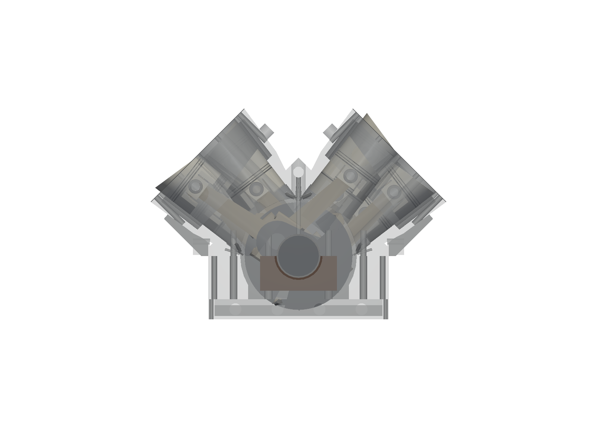<br><em>Four-row arrangement seen from the free end (block transparent).</em></p>


<p><br><em>Transverse section through cylinder 1 (outer row, bank 1).</em></p>


<p><br><em>Crank train inside the transparent crankcase.</em></p>


Envelope from CAD: dressed engine 976 x 900 x 832 mm (L x W x H); long block 796 x 754 x 483 mm.
The published length is 710 mm; this reconstruction's block is 660 mm long and the long block 796 mm including chain housing and crank nose.

## 5. Component design

### 5.1 Crankcase
Split at the crank axis: upper section with both banks, lower bearing support with nine cast-in iron bearing covers (4 bolts each), dry-sump pan.
Zig-zag bores with a 27.9 mm web at the deck and 4.0 mm at the bore foot. Closed deck; the water jacket of each bank is one
connected volume of 1.22 L surrounding all eight bores (CAD-measured), fed at the free end, with four transfer holes per cylinder to the head.
Oil: central gallery dia 18 mm to the nine main bearings and the inner-row piston jets; two side galleries for the outer-row jets.

### 5.2 Crank train
Crankshaft assembly group 32.49 kg, eight bored pins, R2.5 fillets, drilled oil ways. The webs are only 9.5 mm thick and the rods pass between them at BDC,
so counterweights cannot be wider than the webs: each throw is balanced internally to 65-67 % and the sixteen
counterweights are sized so that the resultant force and couple of the complete crank are zero (residual 7.2e-15 kg mm, 1.1e-13 kg mm2).
Titanium I-beam rods with trapezoidal small end; forged pistons with a crown tilted 16.01 deg to the pin-axis normal, three rings, slipper skirt.


<p>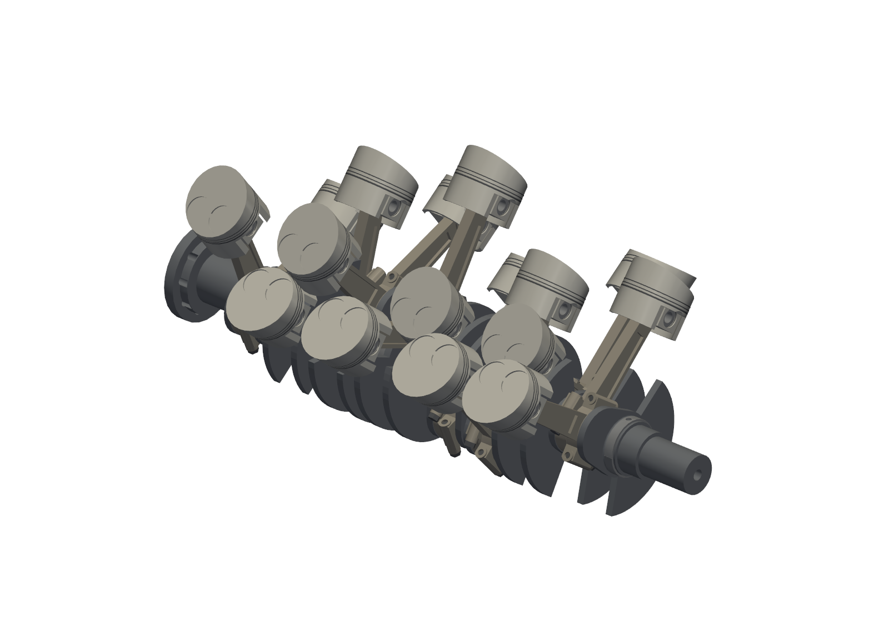<br><em>Crankshaft, rods and pistons.</em></p>


### 5.3 Cylinder heads and valve train
Each head: eight wedge chambers, 16 intake ports from the valley side and 16 exhaust ports outboard (short and long ports alternate), 32 valves,
one row of eight inclined plug wells between the camshafts, a single connected water jacket (2.20 L, CAD-measured), oil galleries with risers to the cam bearings.
Valve sizes 32 / 27 mm, lifts 10.0 / 9.5 mm, follower ratio 2.0. Cam lobes are the exact inner envelope of the dia 17 mm roller.


<p><br><em>Valve train of bank 1 (head semi-transparent, cut).</em></p>


<p><br><em>Timing drive at the flywheel end: duplex primary chain, intermediate shaft, four secondary chains.</em></p>


### 5.4 Turbocharging, intake, exhaust

<p>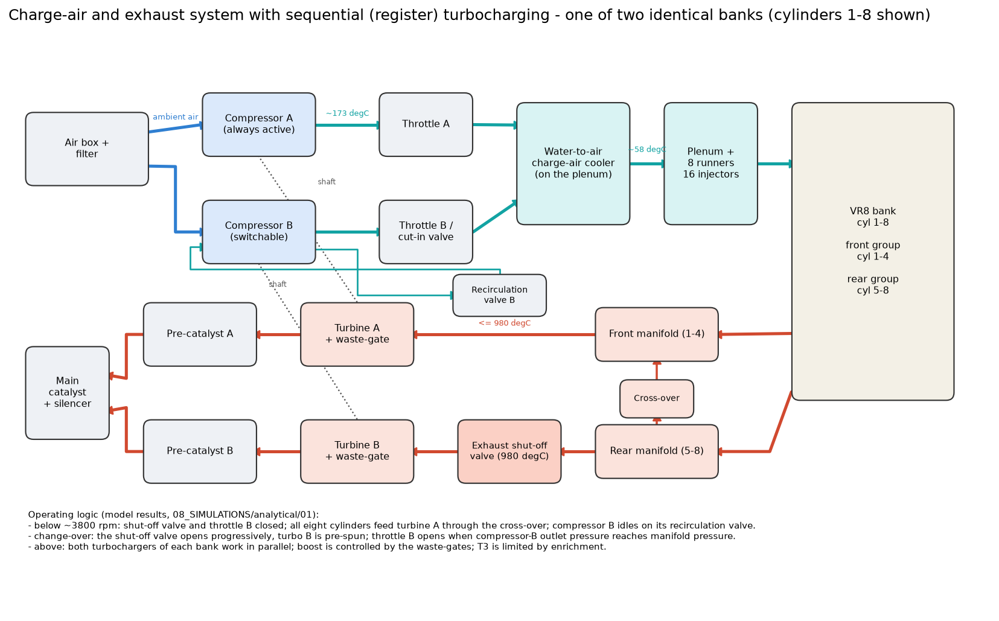<br><em>Flow architecture of one bank.</em></p>


<p>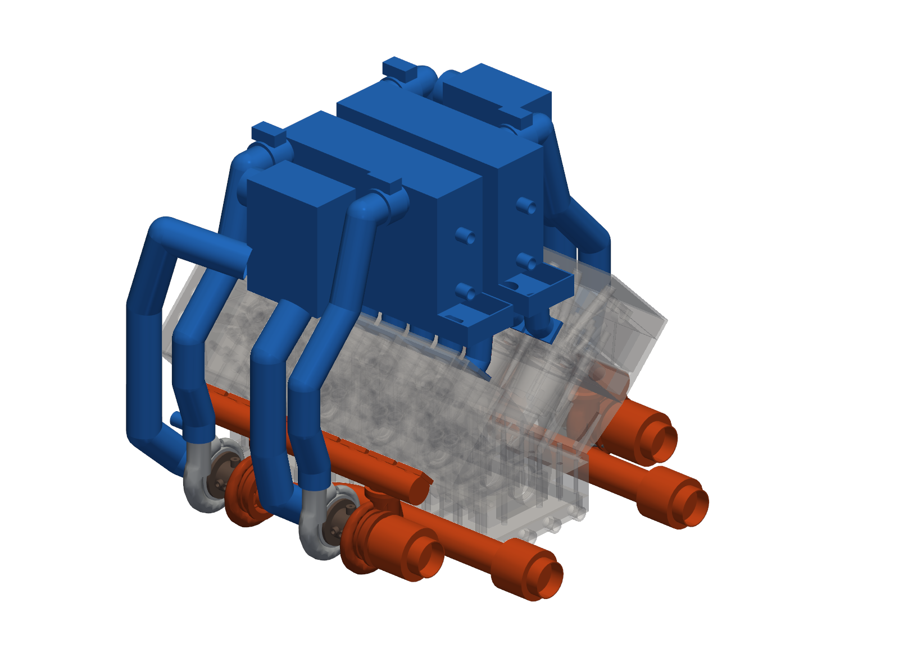<br><em>Turbochargers, exhaust (red) and charge-air system (blue) on the long block.</em></p>


### 5.5 Fuel, ignition, engine management
32 port injectors on four rails, 16 M10 plugs with pencil coils and ion-current measurement, two ECUs (concept). No calibration exists.

<p>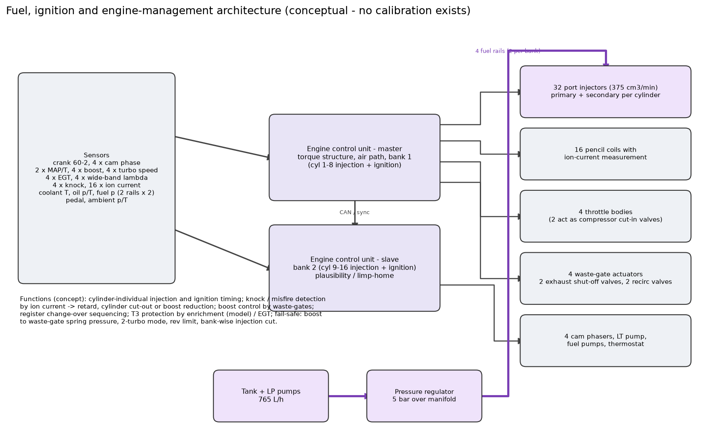<br><em>Engine-management architecture (concept).</em></p>


### 5.6 Lubrication and cooling

<p>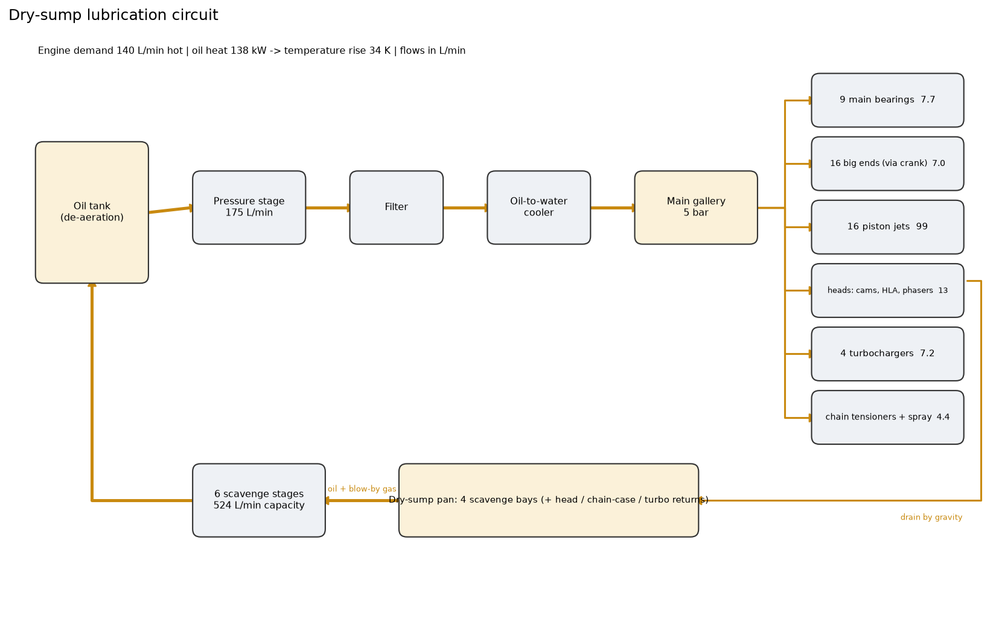<br><em>Dry-sump lubrication circuit with calculated flows.</em></p>


<p><br><em>High- and low-temperature cooling circuits.</em></p>


## 6. Assembly documentation

Hierarchy and masses: `06_ASSEMBLIES/ASSEMBLY_HIERARCHY.md`. Sub-assembly and master STEP files: `06_ASSEMBLIES/step/`, `13_EXPORTS_STEP/`.

| Group | Sub-assembly | Part numbers | Parts | Mass [kg] |
|---|---|---|---|---|
| 01 | Crankcase and cylinder block | 7 | 48 | 97.79 |
| 02 | Cylinder heads | 8 | 152 | 43.51 |
| 03 | Piston assemblies | 5 | 112 | 9.78 |
| 04 | Connecting rods | 5 | 112 | 6.84 |
| 05 | Crankshaft | 1 | 1 | 32.49 |
| 06 | Valvetrain | 13 | 324 | 17.41 |
| 07 | Timing system | 10 | 493 | 5.89 |
| 08 | Turbochargers | 14 | 32 | 22.43 |
| 09 | Intake system | 24 | 24 | 24.66 |
| 10 | Exhaust system | 18 | 18 | 17.86 |
| 11 | Fuel injection and ignition | 7 | 68 | 8.86 |
| 12 | Lubrication system | 6 | 6 | 9.13 |
| 13 | Cooling system | 14 | 14 | 3.79 |
| 14 | Accessory system | 15 | 39 | 32.7 |
| 15 | Fasteners and interfaces | 4 | 154 | 11.11 |

CAD mass 344.3 kg dry, as modelled (published: about 400 kg; the CAD figure includes dressing items such as pre-catalysts, air boxes,
oil tank and charge-air system, and excludes unmodelled small parts and fluids - the two numbers are not directly comparable).


<p><br><em>Exploded view.</em></p>


## 7. Engineering calculations (summary; full reports in `08_SIMULATIONS/analytical/`)

### 7.1 Performance and turbocharger matching

<p><br><em>Full-load model results against the published torque and power.</em></p>


| Quantity at rated power | Model | Published |
|---|---|---|
| Boost pressure | 1.75 bar gauge | not published (about 1.85 bar quoted by secondary sources) |
| Air flow | 60,737 L/min | more than 60,000 L/min |
| Charge-air temperature drop | 115 K | as much as 130 K |
| Turbine inlet temperature | 978 degC (held by enrichment, lambda 0.72) | valve rated 980 degC |
| Peak cylinder pressure | 105 bar | not published |
| BSFC / fuel flow | 383 g/kWh / 567 L/h | - |

Torque and power are model targets, so they match by construction; the informative results are the boost, flows and temperatures and the
fact that the turbocharger power balance closes with four equal turbochargers sized at the change-over point. The same sizing gives full
torque with two turbochargers from about 2,000 rpm, consistent with the published plateau.

<p>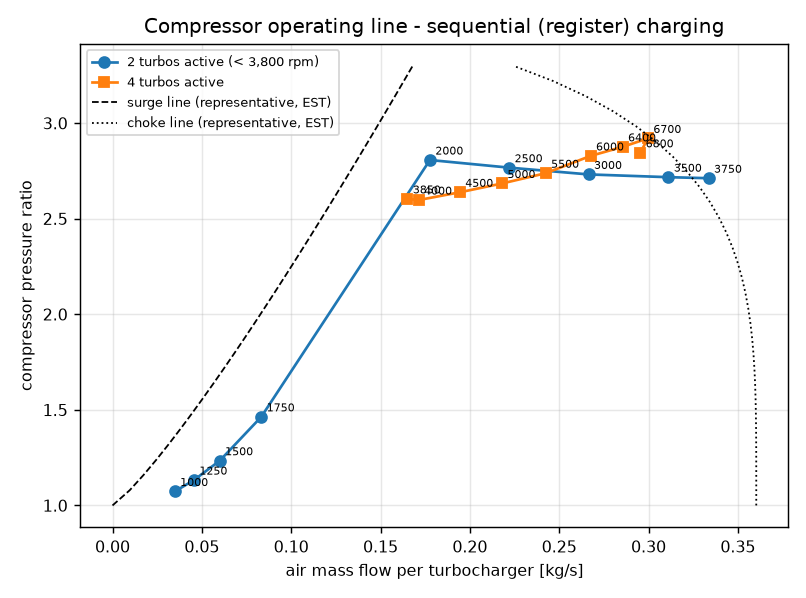<br><em>Compressor operating line (surge/choke lines are representative shapes, not a measured map).</em></p>


### 7.2 Crank train
Rod force 50.9 kN compression at full load, 23.5 kN tension at 7300 rpm; main bearing peak 36.7 kN.
With fully balanced throws the free forces and moments would be 206 N and 39 N m at rated speed (higher orders only). First torsional mode 302 Hz (lumped model).

<p><br><em>Torque ripple and main-bearing load loci.</em></p>


### 7.3 Thermal, lubrication, fuel
Fuel power 4983 kW; to HT coolant 341 kW (temperature rise 6.9 K at 800 L/min); to oil 138 kW;
charge-air coolers 146 kW at effectiveness 0.90. Oil demand 140 L/min, pump 175 L/min.

<p>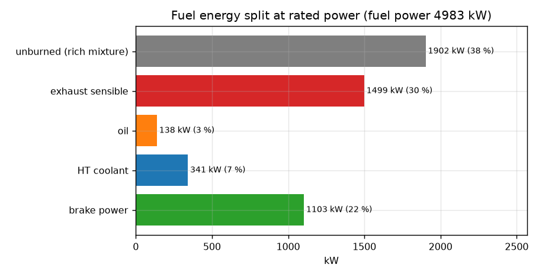<br><em>Fuel-energy split at rated power (model).</em></p>


## 8. Simulation reports (finite elements)

Tools: gmsh tetrahedral meshes of the CAD solids, scikit-fem linear elasticity (P2 unless noted) and steady conduction (P1).
Peak values at re-entrant corners and at fixed boundaries are mesh-dependent; the 99.9th-percentile element stress is reported next to the peak.

| Case | Load case | Mesh | Results | Boundary conditions |
|---|---|---|---|---|
| cylinder block slice, cylinder 3 | gas pressure | 115645 tets, gamma min 0.01 | vm max MPa = 171; vm p999 MPa = 122; max displacement mm = 0.163 | 100 mm slice centred on cylinder 3 (contains its complete bore wall ring); crank-axis split plane fixed; the two cut faces (x = cyl. 3 +/- 50 mm) are symmetry planes (axial displacement fixed); design pressure on the upp |
| cylinder block slice, cylinder 3 | thermal | 115645 tets, gamma min 0.01 | T max C = 189; T bore max C = 189; T bore mean C = 125 | 100 mm slice centred on cylinder 3 (contains its complete bore wall ring); crank-axis split plane fixed; the two cut faces (x = cyl. 3 +/- 50 mm) are symmetry planes (axial displacement fixed); design pressure on the upp |
| cylinder block slice, cylinder 3 | thermal expansion | 115645 tets, gamma min 0.01 | bore radial growth mean um = 57.2; bore out of round um = 509 | 100 mm slice centred on cylinder 3 (contains its complete bore wall ring); crank-axis split plane fixed; the two cut faces (x = cyl. 3 +/- 50 mm) are symmetry planes (axial displacement fixed); design pressure on the upp NOTE: thermal growth with the same supports as the gas case (split plane fixed, cut faces symmetric); includes bending of the bank, so out-of-round is an upper bound |
| crank throw 3 in bending | single load case | 86269 tets, gamma min 0.09 | vm max MPa = 167; vm p999 MPa = 128; pin deflection mm = 0.0159; factor on p999 = 8.14 | both main-journal surfaces fully fixed (stiffer than real bearings -> fillet stress over-predicted); load on the central part of the pin; pulsating load, alternating stress = half the peak |
| cylinder head slice, cylinder position 3 (thermal) | single load case | 56985 tets, gamma min 0.00 | T max C = 339; T valve bridge max C = 220; T valve bridge mean C = 159; T roof mean C = 144; energy balance error pct = 2.14e-12 | cycle-mean chamber heat of one cylinder: roof area at the 1-D roof flux, the valve-head share through the seat-insert pockets; convection on all water-jacket walls inside the slice; port gas-side heat input (exhaust port NOTE: The slice faces (x = position 3 +/- 36.5 mm) cut through the outer intake-valve seat pockets, leaving thin adiabatic slivers; T_max and the gas-side 99th percentile are dominated by these slivers and are slice artefacts. Representative results: valve-bridge maximum and mean, roof mean. |
| main bearing cover (cast-in insert) | single load case | 10763 tets, gamma min 0.24 | vm max MPa = 88.8; vm p999 MPa = 74.5; bore deflection mm = 0.0203; yield factor on p999 = 4.97; peak bearing pressure MPa = 28 | bolt-hole surfaces fixed; support from the surrounding aluminium bedplate neglected (conservative) |
| piston | gas pressure | 81483 tets, gamma min 0.00 | vm max MPa = 171; vm p999 MPa = 107; crown deflection mm = 0.093; peak bearing pressure MPa = 85.3; T at vm max C = 248 | gas and gas + thermal: design gas pressure on all chamber-side surfaces above the top ring (crown, valve pockets, top land; ring-groove and second-land pressures neglected); pin reaction as a cosine bearing pressure on t |
| piston | thermal | 81483 tets, gamma min 0.00 | T max C = 433; T crown mean C = 380; T top ring groove C = 267; energy balance error pct = 4.64e-12 | gas and gas + thermal: design gas pressure on all chamber-side surfaces above the top ring (crown, valve pockets, top land; ring-groove and second-land pressures neglected); pin reaction as a cosine bearing pressure on t |
| piston | gas plus thermal | 81483 tets, gamma min 0.00 | vm max MPa = 277; vm p999 MPa = 139; max displacement mm = 0.391; T at vm max C = 248 | gas and gas + thermal: design gas pressure on all chamber-side surfaces above the top ring (crown, valve pockets, top land; ring-groove and second-land pressures neglected); pin reaction as a cosine bearing pressure on t |
| piston | fatigue estimate | 81483 tets, gamma min 0.00 | factor = 2.05; sigma a MPa = 53.6 - **room-temperature limit: NOT an acceptance measure** (hot fatigue: section 8.1) | gas and gas + thermal: design gas pressure on all chamber-side surfaces above the top ring (crown, valve pockets, top land; ring-groove and second-land pressures neglected); pin reaction as a cosine bearing pressure on t NOTE: gas load from zero to the design pressure every cycle: alternating stress = half the 99.9th-percentile gas-case stress, against the room-temperature fatigue limit (no mean-stress or temperature correction - the hot strength at the boss and ring belt is lower) |
| connecting rod | compression design gas force | 16899 tets, gamma min 0.02 | vm max MPa = 391; vm p999 MPa = 357; yield factor on p999 = 2.47; max axial displacement mm = 0.278; peak bearing pressure MPa = 159 | big-end bore half fixed (loaded half); cosine bearing pressure on the loaded half of the small-end bore; no bolt preload, no contact |
| connecting rod | tension overspeed inertia | 16899 tets, gamma min 0.02 | vm max MPa = 590; vm p999 MPa = 488; yield factor on p999 = 1.81; max axial displacement mm = 0.473; peak bearing pressure MPa = 59.3 | big-end bore half fixed (loaded half); cosine bearing pressure on the loaded half of the small-end bore; no bolt preload, no contact |
| connecting rod | fatigue estimate | 16899 tets, gamma min 0.02 | factor = 1.18; sigma a MPa = 422 | big-end bore half fixed (loaded half); cosine bearing pressure on the loaded half of the small-end bore; no bolt preload, no contact NOTE: alternating stress taken as half the sum of the two p99.9 stresses (conservative, locations differ) |


<p>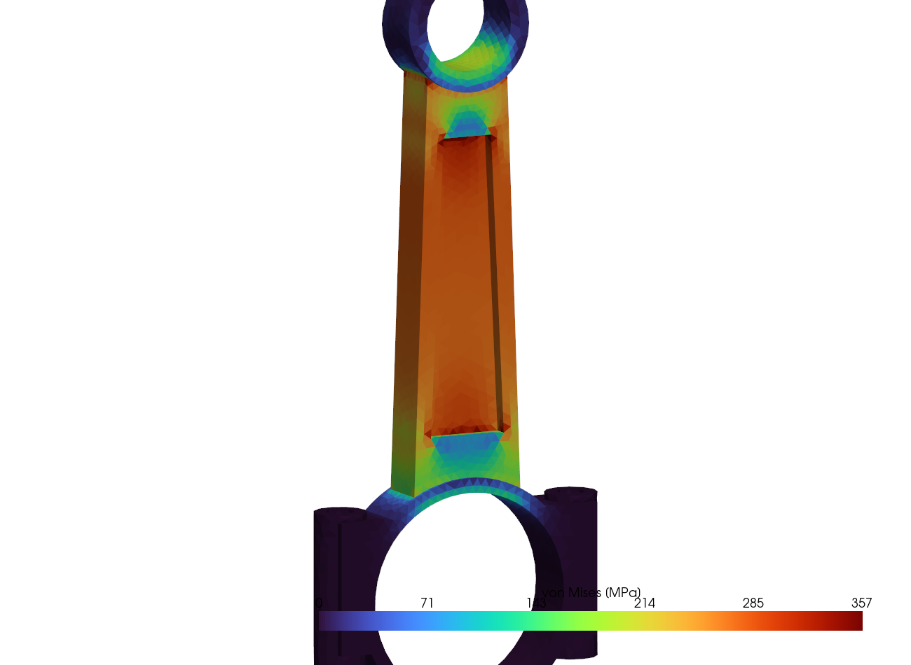<br><em>Connecting rod, design gas force: von Mises stress.</em></p>


<p><br><em>Piston steady temperature field.</em></p>


<p>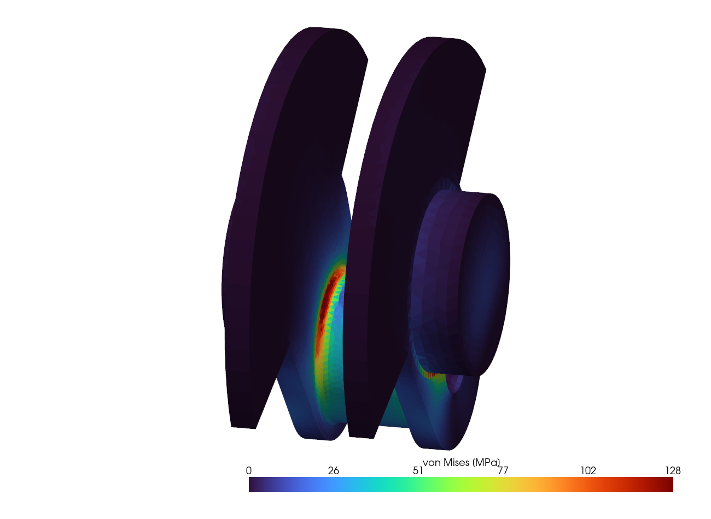<br><em>Crank throw 3 in bending: von Mises stress.</em></p>


<p><br><em>Cylinder-block slice: temperature field.</em></p>


<p>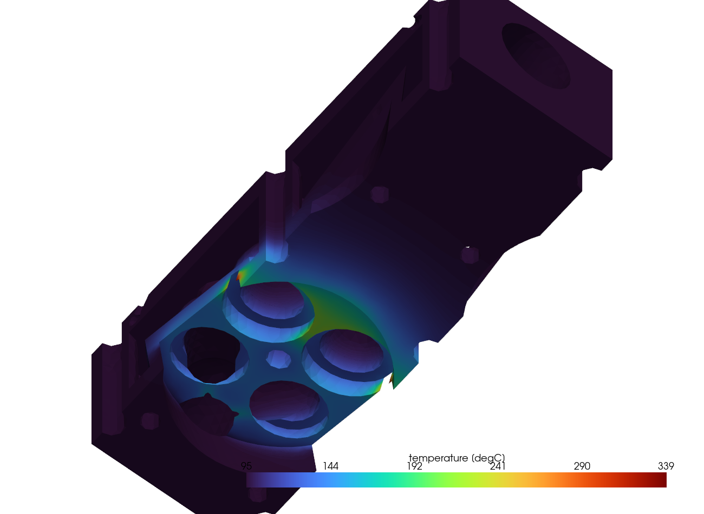<br><em>Cylinder-head slice: temperature field.</em></p>


### Findings from the FE results

- **piston - hot fatigue:** **hot fatigue NOT ASSESSABLE with available public data** (the method fails even production-range temperatures: with Woschni x 1.0 the crown runs at 272 degC, inside the 270-310 degC range of production gasoline pistons, and the factors are still 0.23-0.51); crown 376 degC (heat-consistent, Woschni x 2.0) is above the typical 270-310 degC range - **OPEN: cooling upgrade + hot-strength piston alloy with manufacturer data**. With 4032-T6 lower-bound strength (10,000 h at temperature) the factors are 0.10-0.28; neither they nor the room-temperature factor 2.05 are acceptance measures (sections 8.1, 8.2).
- **cylinder block slice, cylinder 3:** thermal bore distortion up to 509 um (upper bound from a slice with a rigid base; rings typically tolerate a few tens of um) -> bore distortion needs a full-block thermo-mechanical analysis with head clamp load before the liner/jacket design can be accepted.
- **cylinder head slice, cylinder position 3 (thermal):** mesh has 1021 poorly shaped elements (gamma < 0.1); local peaks are unreliable.
- **cylinder head slice, cylinder position 3 (thermal):** valve-bridge temperature up to 220 degC (mean 159 degC), roof mean 144 degC - within the ~250 degC guide limit for cast Al-Si heads. The reported T max (339 degC) is a slice artefact (see note). Exhaust-port heat input was not applied, so exhaust-side temperatures are low.
- **piston:** mesh has 56 poorly shaped elements (gamma < 0.1); local peaks are unreliable.
- **piston - gas pressure:** peak 171 MPa (99.9th percentile 107 MPa) at |x|, |y|, z = 11.8, 19.1, 10.6 mm (pin axis along x, z up from the pin centre) - the corner where the end of the under-crown slot meets the cavity wall and the end of the R3 boss fillet. The concept CAD leaves this corner unradiused, so the peak there depends on the mesh; detail design radiuses it and re-checks. The 99.9th percentile is the basis of the fatigue estimate.
- **piston:** top ring groove 267 degC (within the ~280 degC guide) but crown up to 433 degC, mean 380 degC, at rated power with the estimated oil-side film coefficients (sensitivity - gallery 1,500 W/m2K: crown max 471 / groove 302 degC; gallery 4,000 W/m2K: crown max 398 / groove 234 degC; under-crown 1,000 W/m2K: crown max 413 / groove 254 degC; gallery 4,000 + under-crown 1,000 W/m2K: crown max 383 / groove 226 degC). The crown centre stays above the ~350 degC guide for forged Al-Si pistons in every case studied -> open item: the piston heat load is bracketed in section 8.2 (Woschni x 1.0-2.0); confirm it and the gallery cooling by test; stronger cooling (higher jet flow, under-crown spray) and a hot-strength alloy or steel crown are needed.
- **piston - gas + thermal:** linear-elastic peak 277 MPa (99.9th percentile 139 MPa) at about 248 degC metal temperature. The yield (315 MPa) and fatigue (110 MPa) values in the FE record are room-temperature values; with temperature-dependent strength the stress exceeds even the hot tensile strength of the lower-bound data, and hot fatigue is not assessable with public data (section 8.1), so the pin boss, ring belt and crown need a temperature-dependent elastic-plastic and fatigue analysis with a deformable pin (pin bending and bore contact) before release.
- **piston - top land:** radial growth up to 0.33 mm at rated power against 0.43 mm cold radial clearance (D-040 land relief) and 57 um mean bore growth (block FE) -> about 0.16 mm hot clearance at the tightest point - adequate for the concept; the piston / liner thermal match is a detail-design check.

### 8.1 Piston hot fatigue - temperature-dependent strength (OPEN)

**Result: hot fatigue NOT ASSESSABLE with available public data (the method fails even production-range temperatures: with Woschni x 1.0 the crown runs at 272 degC, inside the 270-310 degC range of production gasoline pistons, and the factors are still 0.23-0.51); crown 376 degC (heat-consistent, Woschni x 2.0) is above the typical 270-310 degC range - OPEN: cooling upgrade + hot-strength piston alloy with manufacturer data.**

Evaluated with temperature-dependent strength (4032-T6, lower-bound data after 10,000 h at temperature): factor
0.10-0.28 over the hot regions (table). **The room-temperature fatigue factor 2.05 in the FE table is not an
acceptance measure**: it compares with the 110 MPa room-temperature limit at metal temperatures of
248-388 degC. **Piston thermal design is an OPEN item.**

| Region (governing element) | Metal temperature [degC] | sigma_a [MPa] | sigma_f(T) [MPa] | Factor | Factor, Goodman | Temperature for factor 1.5, lower-bound data [degC] |
|---|---|---|---|---|---|---|
| Crown above the oil gallery | 388 | 61.4 | 6.4 | 0.10 | 0.08 | 115 (below the 127 degC oil) |
| Crown section under the long-valve pockets | 356 | 58.1 | 7.3 | 0.13 | 0.10 | 124 (below the 127 degC oil) |
| Ring belt at the top ring groove | 301 | 42.3 | 11.6 | 0.27 | 0.21 | 162 |
| Pin bosses | 267 | 53.5 | 15.2 | 0.28 | 0.22 | 138 |
| Slot-end corner under the crown (unradiused in the concept CAD) | 248 | 85.6 | 18.2 | 0.21 | 0.16 | none: room-temperature factor 1.29 (target 1.5) |

Thinnest crown section, 3.3 mm from the pocket floors to the oil-gallery roof: 319-378 degC (mean 354 degC), von Mises up to 116 MPa under gas load and 127 MPa gas + thermal.

The linear-elastic gas + thermal stress (99.9th percentile 139 MPa, peak 277 MPa at 248 degC) exceeds even the hot tensile strength of the alloy (lower-bound data: 63 MPa at 248 degC, 26 MPa at 354 degC), so that result is outside the range of a linear analysis.

Consequences:
- With the lower-bound data the crown would have to run at about 115 degC or less - below the 127 degC oil - so cooling alone cannot reach a factor of 1.5 (best cooling case of the FE sensitivity, gallery 4,000 + under-crown 1,000 W/m2K: crown mean 334 degC against 380 degC); a hot-strength piston material or a steel crown, with measured hot fatigue data, and/or lower crown stresses are needed.
- **Slot-end corner:** misses the 1.5 target (room-temperature factor 1.29, above 1.0 but below the 1.5 target, whatever the crown temperature) at a corner the concept CAD leaves unradiused, so the value is mesh-dependent: it needs a real radius and a mesh-converged re-check (OPEN). Its hot factor in the table is mesh-dependent for the same reason.
- A heavier piston loads the titanium rod: rod fatigue factor 1.18 now, about 0.044 lower per 50 g of reciprocating mass (0.741 kg now; the overspeed tension scales with it).

Method: sigma_a = 0.5 x gas-case element von Mises; sigma_f(T) = 110 MPa x UTS(T) / UTS(RT), UTS of 4032-T6 after 10,000 h at temperature (EST scaling); factor = sigma_f(T) / sigma_a; Goodman: 1 / (sigma_a / sigma_f(T) + sigma_m / UTS(T)) with sigma_m = sigma_a. Element means (no extrapolation to the surface); the slot-end corner is unradiused in the concept CAD, so its value is mesh-dependent.

Source: ASM Handbook Vol. 2, Properties and Selection: Nonferrous Alloys and Special-Purpose Materials (ASM International, 1990), wrought alloy 4032: typical tensile properties of 4032-T6 at elevated temperature (after 10,000 h at temperature) and fatigue strength 110 MPa at 5e8 cycles (R.R. Moore). Also tabulated in J.G. Kaufman, Properties of Aluminum Alloys: Tensile, Creep, and Fatigue Data at High and Low Temperatures (ASM International / The Aluminum Association, 1999).

Short-exposure (upper-bound) strength data were not evaluated: the fatigue strength needed for a factor of 1.5 at the operating temperatures is 0.58-0.84 of the room-temperature value (1.17 at the slot-end corner); the project judged on 2026-11-20 that short-exposure data cannot change the conclusion. 

**Why not assessable:** the same data and method applied to the crown temperatures of the Woschni x 1.0 case (crown mean 272 degC, inside the published 270-310 degC range of production gasoline pistons) give factors 0.23-0.51 (section 8.2). At 270-310 degC the lower-bound data allow sigma_f = 14.9-10.7 MPa, so a factor of 1.5 would need a gas-load von Mises stress below 20-14 MPa - production pistons run at these temperatures, so tensile data after 10,000 h of static exposure, scaled to fatigue, cannot separate an acceptable piston from an unacceptable one. A verdict needs measured hot fatigue data of the actual piston alloy (manufacturer data).

Evaluation: `tools/piston_section_fatigue.py` -> `08_SIMULATIONS/fea/piston_section_fatigue.json`.

### 8.2 Piston heat input - Woschni multiplier (study of 2026-11-21)

The piston heat comes from the cycle model's Woschni correlation, scaled by `woschni_scale` = 2.0. The rated point
(6700 rpm, 1,103 kW) was re-solved with multipliers 1.0 / 1.5 / 2.0 on the same hardware (turbine area and
torque target unchanged), and the piston FE was run thermal-only with each heat input; the cycle's piston wall temperature is iterated to
the FE crown temperature so that heat and temperature are consistent ("heat-consistent").

| Woschni x | Piston heat per cylinder [W] | W/mm2 of crown | % of burned (of supplied) fuel energy | Crown mean / max [degC] | Top ring groove [degC] | T3 [degC] (limit 980) | Coolant heat / brake power | Worst hot-fatigue factor (8.1 method) |
|---|---|---|---|---|---|---|---|---|
| 1.0 | 3,059 | 0.51 | 1.6 (1.0) | 272 / 301 | 210 | 1028 (over limit) | 0.21 | 0.23 |
| 1.5 | 4,294 | 0.71 | 2.3 (1.4) | 327 / 368 | 239 | 1004 (over limit) | 0.26 | 0.14 |
| 2.0 | 5,376 | 0.89 | 2.8 (1.7) | 376 / 427 | 264 | 981 | 0.31 | 0.10 |

The committed piston FE (section 8) uses the cycle model's wall temperature (560 K) for the gas-side calibration: 5,988 W
per piston, crown mean 380 degC; the heat-consistent value is 376 degC.

Comparison with published values:

- Share of fuel energy into the piston: about 3-5 % in quiescent combustion chambers ([DieselNet, Piston Cooling](https://dieselnet.com/tech/combustion_piston-cool.php)).
  The model gives 1.6 % (x 1.0) to 2.8 % (x 2.0) of the burned fuel energy
  (the model burns 61.8 % of the supplied fuel at lambda 0.72); only x 2.0 comes close to the range.
- Crown temperature: 270-310 degC at the crown centre and 200-280 degC at the top ring groove (gallery-cooled) for production gasoline
  pistons of the 1990s (same source, MAHLE data). This engine runs at 138 kW/L, or
  11.9 MW of brake power per m2 of piston area (DieselNet's scale: 1 MW/m2 ~ 10 kW/L), so a crown above that
  range is plausible; x 1.0 lands inside it (272 degC), which is low for this specific power.
- Heat flux: no published cycle-averaged piston heat flux for a turbocharged gasoline engine at full load was found. Measured peak surface
  heat flux at wide-open throttle is 1.2-5 MW/m2 ([SAE 930217](https://www.sae.org/publications/technical-papers/content/930217/)), of order 1-3 MW/m2 ([MIT 2.61](https://web.mit.edu/2.61/www/Lecture%20notes/Lec.%2018%20Heat%20transf.pdf));
  the model's 0.5-0.9 MW/m2 cycle mean is plausible below those peaks (inference, not a published value).
- Woschni-type correlations need a multiplier calibrated per engine and operating point ([review](https://www.researchgate.net/publication/238186418)).

**Decision (D-045):** `woschni_scale` stays 2.0 - the only multiplier that comes close to the published piston heat share and
keeps T3 at the published 980 degC limit (x 1.0 and x 1.5 run 48 and
24 K over it with the enrichment already at its limit, lambda 0.72);
the uncertainty band is x 1.0-2.0 (crown 272-376 degC). The earlier note that the multiplier was calibrated to coolant heat of
0.4-0.5 x brake power was wrong (the model gives 0.31) and is withdrawn. Whatever the multiplier, the hot-fatigue factors stay far below 1
(table) - see 8.1 for why that check cannot give a verdict with public data.

Evaluation: `tools/piston_heat_input_study.py` -> `08_SIMULATIONS/analytical/piston_heat_input_study.json`.

Limitations of the FE work: linear elastic, no contact, no bolt preload, no bearing films, simplified supports, slices instead of the complete
castings, cycle-mean thermal loads from the 0-D model, no fatigue solver (factors are simple ratios against handbook limits).

## 9. Validation results

- **Compression ratio from CAD volumes:** cyl 1: 9.00 (V_tdc 62.4 cm3), cyl 2: 9.00 (V_tdc 62.4 cm3); target 9.0.
- **Firing intervals:** 45.000 deg for all 16 cylinders (numerical TDC search).
- **Interference check:** all 7557 static candidate pairs checked, 12 crank angles. Of 7557 static candidate pairs (bounding boxes overlapping, 1597 placed solids):
  4850 clear, 2497 intentional contacts by rule (threads, press fits, seats), 93 touching with no overlap
  (zero distance; the common of the two solids, cut to their bounding-box overlap, is empty and the fuse residual is within volume-integration noise), 0 boolean errors, 0 not checked; 35 static clash pairs.
  Kinematic sweep over 12 crank angles: 11886 pair checks clear, 0 touching, 1 clash pairs, boolean errors 0.

| Check | Part A | Part B | Occurrences | Max overlap [mm3] |
|---|---|---|---|---|
| static | W16-09-air_duct_B-L1 | W16-09-charge_pipe_B-L1 | 1 | 1488 |
| static | W16-09-air_duct_B-L2 | W16-09-charge_pipe_B-L2 | 1 | 1487 |
| static | W16-09-air_duct_A-L1 | W16-10-downpipe_B-L1 | 1 | 840.7 |
| static | W16-09-air_duct_A-L2 | W16-10-downpipe_B-L2 | 1 | 838.5 |
| static | W16-07-008~10 | W16-07-010 | 1 | 598.9 |
| static | W16-07-008~03 | W16-07-010 | 1 | 521 |
| static | W16-07-008~05 | W16-07-010 | 1 | 468.9 |
| static | W16-07-008~08 | W16-07-010 | 1 | 468.9 |
| static | W16-13-pipe_pump_to_block_2 | W16-14-front_cover | 1 | 238.7 |
| static | W16-13-pipe_pump_to_block_1 | W16-14-front_cover | 1 | 238.7 |
| static | W16-07-008~09 | W16-07-010 | 1 | 223.2 |
| static | W16-07-008~04 | W16-07-010 | 1 | 175.7 |
| static | W16-07-008~06 | W16-07-009 | 1 | 149.7 |
| static | W16-07-008~04 | W16-07-009 | 1 | 149.6 |
| static | W16-08-003 | W16-10-downpipe_B-L1 | 1 | 137.9 |
| static | W16-08-004 | W16-10-downpipe_B-L2 | 1 | 137.9 |
| static | W16-08-003 | W16-10-shutoff_valve-L1 | 1 | 128.4 |
| static | W16-08-004 | W16-10-shutoff_valve-L2 | 1 | 128.4 |
| static | W16-02-001 | W16-11-rail_P-L1 | 1 | 118.5 |
| static | W16-02-002 | W16-11-rail_P-L2 | 1 | 118.5 |
| static | W16-01-001 | W16-14-mount_bracket_R | 1 | 97.79 |
| static | W16-01-001 | W16-14-mount_bracket_L | 1 | 97.79 |
| static | W16-07-006 | W16-07-010 | 34 | 96.57 |
| static | W16-11-003~0 | W16-11-003~1 | 16 | 82.45 |
| static | W16-07-008~07 | W16-07-010 | 1 | 47.63 |
| static | W16-07-008~06 | W16-07-010 | 1 | 47.63 |
| static | W16-07-006 | W16-07-009 | 4 | 47.14 |
| static | W16-04-003 | W16-05-001 | 32 | 26.53 |
| static | W16-08-014 | W16-10-precat_A-L2 | 1 | 25.69 |
| static | W16-08-013 | W16-10-precat_A-L1 | 1 | 25.69 |
| static | W16-08-004 | W16-10-precat_A-L2 | 1 | 21.2 |
| static | W16-08-003 | W16-10-precat_A-L1 | 1 | 21.2 |
| static | W16-13-pump_inlet_pipe | W16-13-water_pump_impeller | 1 | 6.81 |
| static | W16-13-pipe_pump_to_block_2 | W16-13-water_pump_impeller | 1 | 4.87 |
| static | W16-13-pipe_pump_to_block_1 | W16-13-water_pump_impeller | 1 | 4.87 |
| kinematic | W16-04-003 | W16-05-001 | 96 | 26.53 |

These remaining overlaps are packaging errors of this concept model and are listed as open work; they are not hidden.
- **Piston-to-valve clearance, spring loads, transverse head clearances:** `08_SIMULATIONS/analytical/03_valvetrain.md`.
- **Comparison with published targets:** section 7.1.

## 10. Acceptance criteria

| Criterion | Result | Evidence |
|---|---|---|
| All sixteen cylinders are represented | PASS | 16 bores in the block CAD; pistons x16 |
| Four cylinder banks (rows) correctly organised | PASS | two VR8 banks at 90 deg, each with two rows at 15 deg; firing intervals 45.000 deg (layout check) |
| Engine architecture mechanically coherent | PARTIAL - packaging overlaps listed | interference check: 35 static and 1 kinematic clash pairs remain (listed in the report) |
| Displacement consistent with bore and stroke | PASS | 7992.92 cm3 vs 7,993 cm3 published |
| All sixteen piston assemblies modelled | PASS | pistons 16, pins 16, rings 48 |
| Shared crankshaft modelled | PASS | one-piece crank, 8 pins, 9 mains, distributed counterweights |
| All connecting rods represented | PASS | rods x16 with caps, shells, bushes, bolts |
| Cylinder heads and the 64-valve system modelled | PASS | 64 valves, 64 springs/retainers/followers/support elements, 4 camshafts; **two head castings serve the four rows** (documented architecture, decision D-003) |
| Four turbochargers modelled | PASS | 2 RH + 2 LH units with housings, wheels, bearing housing, actuator |
| Sequential turbocharging flow architecture documented | PASS | diagram + animation + matching calculation |
| Intake and exhaust systems connected | PASS | manifolds, coolers, charge pipes, logs, cross-over, down-pipes modelled per bank |
| Fuel injection and ignition represented | PASS | 32 injectors, 4 rails, 16 plugs, 16 coils; EMS architecture diagram |
| Lubrication and cooling circuits modelled | PASS | galleries and jackets are real passages in block/heads; external circuit parts and 1-D flow calculations |
| Major mechanical interfaces validated | PARTIAL | CAD interference check (static all-pairs + 12 crank angles); CAD compression ratio 9.00, 9.00 |
| Parametric CAD files editable | PASS | geometry is generated from `src/w16/params.py`; BREP per part in `05_COMPONENT_CAD/` |
| STEP exports generated | PASS | 166 component STEP files; master assembly 186.33 MB; 15 sub-assemblies |
| STL and 3MF exports generated where supported | PASS | 166 STL, 159 3MF component files |
| Exploded assembly documentation complete | PASS | exploded views + hierarchy |
| Engineering drawings available | PASS | 9 sheets (PDF/SVG/PNG) |
| Simulation evidence documented | PASS | FE cases run: block, crank, head, insert, piston, rod; not run: none; 0-D/1-D models in `08_SIMULATIONS/analytical`. No 3-D CFD. |
| BOM complete | PASS | 151 part numbers (modelled content only) |
| Final technical report produced | see file | `12_FINAL_REPORT/` (Markdown + PDF) |
| Deliverables organised in the structured directory | PASS | folders 01-14 + 00_PROJECT_CONTROL + src |
| Piston at operating temperature: hot fatigue (engineering check added 2026-11-20, not in brief section 21) | NOT ASSESSABLE - OPEN | **hot fatigue NOT ASSESSABLE with available public data** (the method fails even production-range temperatures: with Woschni x 1.0 the crown runs at 272 degC, inside the 270-310 degC range of production gasoline pistons, and the factors are still 0.23-0.51); crown 376 degC (heat-consistent, Woschni x 2.0) is above the typical 270-310 degC range - **OPEN: cooling upgrade + hot-strength piston alloy with manufacturer data**; factor 0.10-0.28 with 4032-T6 strength after 10,000 h at temperature (section 8.1); the room-temperature factor 2.05 is not an acceptance measure |

## 11. Bill of materials and procurement

151 part numbers; see `10_BOM_AND_PROCUREMENT/BOM.md` / `BOM.csv`. No costs are given because no reliable price source exists.

## 12. Materials and manufacturing

See `11_MANUFACTURING_DOCUMENTATION/MANUFACTURING_SPEC.md` (materials, processes, critical dimensions, tolerance classes, inspection, assembly sequence, maintenance).

## 13. Drawings, exports, animations

- Drawings: `07_ENGINEERING_DRAWINGS/` (9 PDF sheets, also SVG/PNG).
- STEP: `13_EXPORTS_STEP/` (master assembly + components); sub-assemblies in `06_ASSEMBLIES/step/`. STL / 3MF: `14_EXPORTS_STL_3MF/`.
- Animations: `09_ANIMATIONS/` (7 GIF, 7 MP4).

## 14. Known engineering limitations

1. No manufacturer geometry: every internal dimension is a reconstruction. The model shows that the public data are mutually consistent; it does not reproduce the real parts.
2. No 3-D CFD of any kind (ports, plenum, coolant jacket, combustion). Flow results are 0-D / 1-D.
3. The cycle model is uncalibrated; enrichment, boost and temperatures are plausible estimates. Knock is not modelled.
4. Turbomachinery is sized, not designed: wheels and volutes are representative shapes; there are no compressor or turbine maps.
5. FE is linear and local (see section 8). No fatigue, no bearing elasto-hydrodynamics, no valve-train dynamics, no crank 3-D torsional/bending model, no thermal-mechanical head analysis with valve-bridge detail.
6. Purchased units (injectors, coils, sensors, pumps, alternator, phasers, tensioners) are envelopes. Seals, O-rings, dowels, clips, brackets, most small fasteners, hoses and the detailed harness are not modelled.
7. Castings have no draft, fillets or wall-thickness optimisation; mass is therefore indicative.
8. Tolerances are classes, not a stack-up. Drawings are layout drawings.
9. The valve-train conflicts found earlier are resolved: the long-valve spring through the short valve's support element (D-031) by the D-034 layout; the camshafts through the closed head / cover end walls, the retainers in the camshaft bearing webs, the opening long valves and the piston crown in a wedge left by the chamber cut, the follower pads on the valve tips and the cam / roller fit by D-039. The interference check finds no valve-train clashes. The finger ratio of 2.7 on the short valves is high and needs a stiffness / contact-stress check. Remaining packaging overlaps are listed in section 9.
10. The engine-management description is an architecture, not software.
11. **Piston:** **hot fatigue NOT ASSESSABLE with available public data** (the method fails even production-range temperatures: with Woschni x 1.0 the crown runs at 272 degC, inside the 270-310 degC range of production gasoline pistons, and the factors are still 0.23-0.51); crown 376 degC (heat-consistent, Woschni x 2.0) is above the typical 270-310 degC range - **OPEN: cooling upgrade + hot-strength piston alloy with manufacturer data**. With 4032-T6 lower-bound strength (10,000 h at temperature) the factors are 0.10-0.28; neither they nor the room-temperature factor 2.05 are acceptance measures (sections 8.1, 8.2). The slot-end corner under the crown misses the 1.5 target (room-temperature factor 1.29, above 1.0 but below the 1.5 target, whatever the crown temperature) at a corner the concept CAD leaves unradiused, so the value is mesh-dependent: it needs a real radius and a mesh-converged re-check. A cooling / material decision and a new piston FE are needed before the piston is mechanically acceptable.

## 15. Future development recommendations

1. Resolve the listed interferences and add draft/fillets to castings; then repeat the mass and FE work on full castings.
2. 1-D gas-dynamics model (GT-Power class) with real turbocharger maps; then 3-D CFD of ports, plenum distribution and water jackets.
3. Elasto-hydrodynamic bearing analysis and a flexible multi-body crank and valve-train simulation; damper tuning.
4. Thermo-mechanical fatigue analysis of head and manifolds; piston secondary motion and ring-pack analysis.
5. Tolerance stack-ups for the chamber volume (CR scatter), valve train and timing drive.
6. Supplier engagement for turbochargers, bearings and valve train; replace envelopes by supplier CAD.
7. Prototype sequence: single-bank VR8 test rig for combustion and cooling development before the full W16.
8. Piston: confirm the piston heat load by test (bracketed in section 8.2), upgrade the crown cooling and choose a hot-strength piston alloy or steel crown with manufacturer hot-fatigue data (check the rod for any mass increase), radius the slot-end corner, then a temperature-dependent elastic-plastic piston FE.

## 16. Reproducing the package

```
set PYTHONPATH=src
.venv\Scripts\python -m w16.reports            analytical package
.venv\Scripts\python -m w16.cad.assembly       CAD build + summary
.venv\Scripts\python -m w16.cad.export all     exports, hierarchy, validation
.venv\Scripts\python -m w16.cad.export interference
.venv\Scripts\python -m w16.cad.render         views and animations
.venv\Scripts\python -m w16.cad.drawings       drawings
.venv\Scripts\python -m w16.sim.fea            finite-element cases
.venv\Scripts\python -m w16.diagrams           schematics
.venv\Scripts\python -m w16.docs               BOM, manufacturing spec, this report
```
