# W16 engine reconstruction - engineering design report

**Subject:** 8.0-litre, quad-turbocharged W16 reconstructed from publicly documented information on the Bugatti Chiron engine.
**Status:** concept-level digital engineering package (analysis + parametric CAD + linear FE). Not manufacturer data, not released for manufacture.
**Date:** 2026-11-14. **Generated by:** `python -m w16.docs` from the evidence files in this repository.

## 1. Project overview

The package reconstructs the architecture of the W16 from public sources and fills every gap with a labelled engineering
value. Each number carries a tag: PUB (published), SEC (secondary source), CALC (calculated here), EST (engineering estimate).
What exists:

| Deliverable | Content |
|---|---|
| Research + reference specification | sources with confidence levels, firing-order consistency proof, parameter table |
| Analytical models | 0-D cycle and turbo matching, crank-train dynamics and balance, valve train, thermal / lubrication / fuel sizing |
| Parametric CAD | 151 part numbers, 1599 placed parts, 15 sub-assemblies, generated from one parameter file |
| Checks | CAD compression ratio, interference (static + 12 crank angles), mass and envelope |
| FE | 6 linear structural / thermal cases on the CAD solids |
| Outputs | STEP / BREP / STL / 3MF, drawings, renders, exploded and section views, animations, BOM, manufacturing specification |


<p>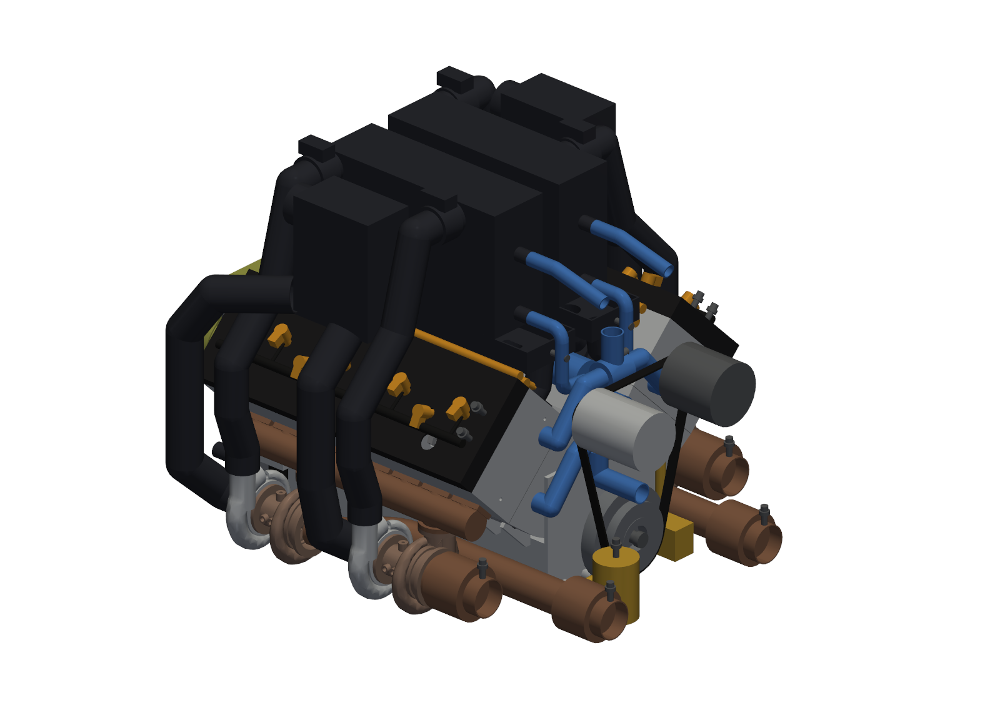<br><em>Dressed engine, isometric view from the free end (CAD render).</em></p>


## 2. Reference specifications

| Item | Value | Tag |
|---|---|---|
| Configuration | W16: two VR8 banks at 90 deg, each with two rows at 15 deg; one crankshaft | PUB |
| Displacement | 7,993 cm3 (7992.92 cm3 from 86 x 86 mm) | PUB / CALC |
| Power / torque | 1,103 kW (1,500 PS) at 6,700 rpm; 1,600 N m from 2,000 to 6,000 rpm | PUB |
| Charging | four equal turbochargers, two per bank, sequential; second pair from about 3,800 rpm | PUB |
| Injection | duplex, 32 injectors | PUB |
| Cylinder pitch | 73 mm | PUB |
| Firing | 45 deg intervals; order 1-14-9-4-7-12-15-6-13-8-3-16-11-2-5-10 | PUB / SEC |
| Compression ratio | 9.0 | SEC |
| Cooling | 800 L/min HT pump; separate LT charge-air circuit; charge air cooled by up to 130 K | PUB |
| Mass / length | about 400 kg / 710 mm | PUB / SEC |

Full list and sources: `03_REFERENCE_SPECIFICATIONS/REFERENCE_SPEC.md`, `01_RESEARCH/RESEARCH_LOG.md`.

## 3. Engineering assumptions

All provisional values are in `03_REFERENCE_SPECIFICATIONS/MASTER_PARAMETERS.md` (tag EST) and every non-obvious choice is in
`00_PROJECT_CONTROL/DECISIONS.md`. The most consequential ones:

- **Two cylinder-head castings, not four** - one head serves both rows of a bank (documented VR/W principle). The brief's "four heads" is read as four cylinder rows.
- Cylinders k and k+8 share crankpin k; nine main bearings; rod 164 mm and row offset 12.5 mm taken from the VW W12 family (SSP 248).
- Valve train: two camshafts per head 54 mm apart, roller finger followers, short and long valves; chamber roof tilted 16.4 deg; piston crown tilted to give CR 9.0.
- Because the camshafts are only 54 mm apart, each camshaft has its own secondary chain in its own plane (four secondary chains). The VW W engines use one chain per head; this is a consequence of this reconstruction's head layout.
- Exhaust grouped front/rear per bank; turbine A permanently fed, turbine B behind a shut-off valve.
- Cycle-model constants (Woschni multiplier 2.0, combustion phasing, efficiencies) are textbook values, not calibration.

## 4. Engine architecture

Coordinate system: X = crank axis (+X flywheel end), Z up, bank 1 (cyl 1-8) towards +Y. Crank throw 42.868 mm (offset bores make the
stroke larger than twice the throw), deck height 237.27 mm, bore centres +/-43.74 mm at the deck, bank offset 18.0 mm.
Crankpin phases are derived from the published firing order; the two cylinders on every pin require the same pin angle to 1e-13 deg and
all firing intervals found numerically are 45.000 deg, which shows the published order and the shared-pin 90 deg layout are mutually consistent.


<p><br><em>Four-row arrangement seen from the free end (block transparent).</em></p>


<p>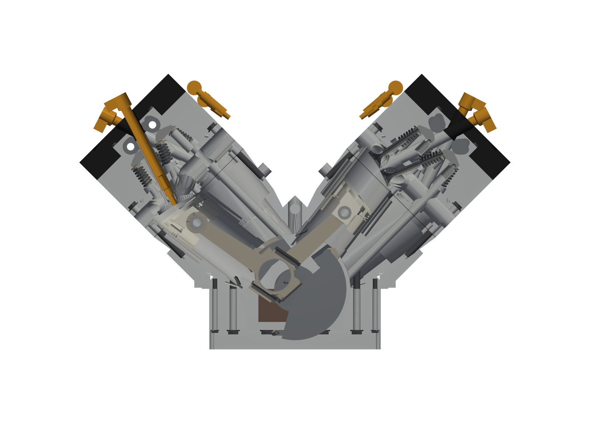<br><em>Transverse section through cylinder 1 (outer row, bank 1).</em></p>


<p>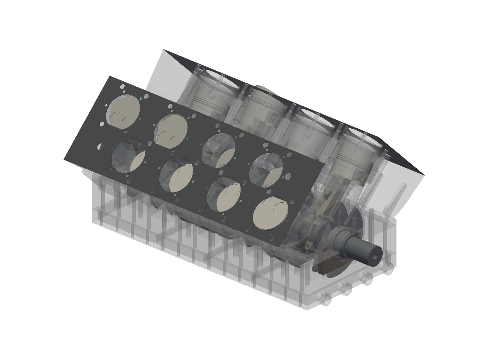<br><em>Crank train inside the transparent crankcase.</em></p>


Envelope from CAD: dressed engine 976 x 900 x 832 mm (L x W x H); long block 796 x 754 x 483 mm.
The published length is 710 mm; this reconstruction's block is 660 mm long and the long block 796 mm including chain housing and crank nose.

## 5. Component design

### 5.1 Crankcase
Split at the crank axis: upper section with both banks, lower bearing support with nine cast-in iron bearing covers (4 bolts each), dry-sump pan.
Zig-zag bores with a 27.9 mm web at the deck and 4.0 mm at the bore foot. Closed deck; the water jacket of each bank is one
connected volume of 1.22 L surrounding all eight bores (CAD-measured), fed at the free end, with four transfer holes per cylinder to the head.
Oil: central gallery dia 18 mm to the nine main bearings and the inner-row piston jets; two side galleries for the outer-row jets.

### 5.2 Crank train
Crankshaft assembly group 32.49 kg, eight bored pins, R2.5 fillets, drilled oil ways. The webs are only 9.5 mm thick and the rods pass between them at BDC,
so counterweights cannot be wider than the webs: each throw is balanced internally to 65-67 % and the sixteen
counterweights are sized so that the resultant force and couple of the complete crank are zero (residual 7.4e-15 kg mm, 1.8e-12 kg mm2).
Titanium I-beam rods with trapezoidal small end; forged pistons with a crown tilted 15.76 deg to the pin-axis normal, three rings, slipper skirt.


<p><br><em>Crankshaft, rods and pistons.</em></p>


### 5.3 Cylinder heads and valve train
Each head: eight wedge chambers, 16 intake ports from the valley side and 16 exhaust ports outboard (short and long ports alternate), 32 valves,
one row of eight inclined plug wells between the camshafts, a single connected water jacket (2.20 L, CAD-measured), oil galleries with risers to the cam bearings.
Valve sizes 32 / 27 mm, lifts 10.0 / 9.5 mm, follower ratio 2.0. Cam lobes are the exact inner envelope of the dia 17 mm roller.


<p>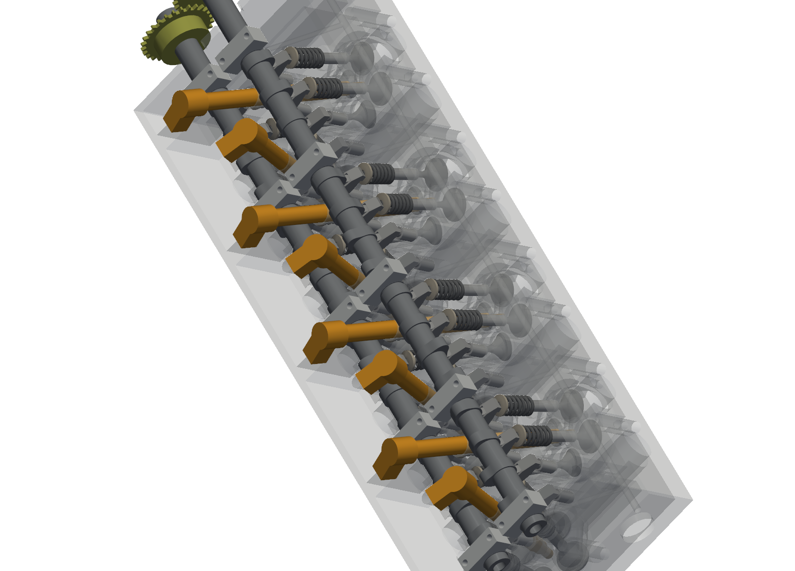<br><em>Valve train of bank 1 (head semi-transparent, cut).</em></p>


<p>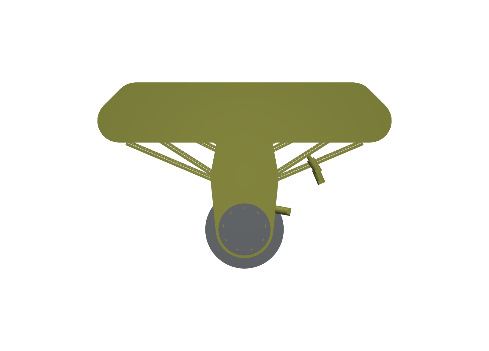<br><em>Timing drive at the flywheel end: duplex primary chain, intermediate shaft, four secondary chains.</em></p>


### 5.4 Turbocharging, intake, exhaust

<p><br><em>Flow architecture of one bank.</em></p>


<p><br><em>Turbochargers, exhaust (red) and charge-air system (blue) on the long block.</em></p>


### 5.5 Fuel, ignition, engine management
32 port injectors on four rails, 16 M10 plugs with pencil coils and ion-current measurement, two ECUs (concept). No calibration exists.

<p><br><em>Engine-management architecture (concept).</em></p>


### 5.6 Lubrication and cooling

<p><br><em>Dry-sump lubrication circuit with calculated flows.</em></p>


<p>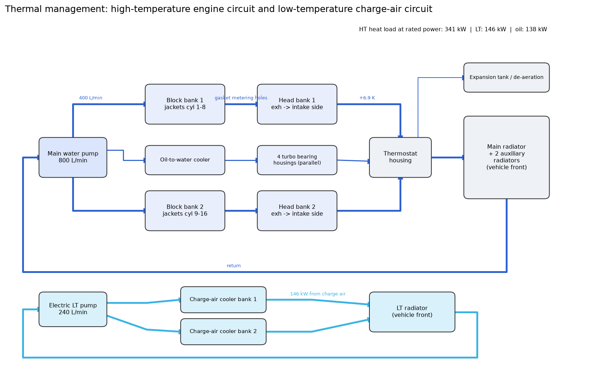<br><em>High- and low-temperature cooling circuits.</em></p>


## 6. Assembly documentation

Hierarchy and masses: `06_ASSEMBLIES/ASSEMBLY_HIERARCHY.md`. Sub-assembly and master STEP files: `06_ASSEMBLIES/step/`, `13_EXPORTS_STEP/`.

| Group | Sub-assembly | Part numbers | Parts | Mass [kg] |
|---|---|---|---|---|
| 01 | Crankcase and cylinder block | 7 | 48 | 97.88 |
| 02 | Cylinder heads | 8 | 152 | 43.51 |
| 03 | Piston assemblies | 5 | 112 | 9.81 |
| 04 | Connecting rods | 5 | 112 | 6.84 |
| 05 | Crankshaft | 1 | 1 | 32.49 |
| 06 | Valvetrain | 13 | 324 | 17.5 |
| 07 | Timing system | 10 | 495 | 5.9 |
| 08 | Turbochargers | 14 | 32 | 22.43 |
| 09 | Intake system | 24 | 24 | 24.66 |
| 10 | Exhaust system | 18 | 18 | 17.87 |
| 11 | Fuel injection and ignition | 7 | 68 | 8.86 |
| 12 | Lubrication system | 6 | 6 | 9.13 |
| 13 | Cooling system | 14 | 14 | 3.79 |
| 14 | Accessory system | 15 | 39 | 32.7 |
| 15 | Fasteners and interfaces | 4 | 154 | 11.11 |

CAD mass 344.5 kg dry, as modelled (published: about 400 kg; the CAD figure includes dressing items such as pre-catalysts, air boxes,
oil tank and charge-air system, and excludes unmodelled small parts and fluids - the two numbers are not directly comparable).


<p>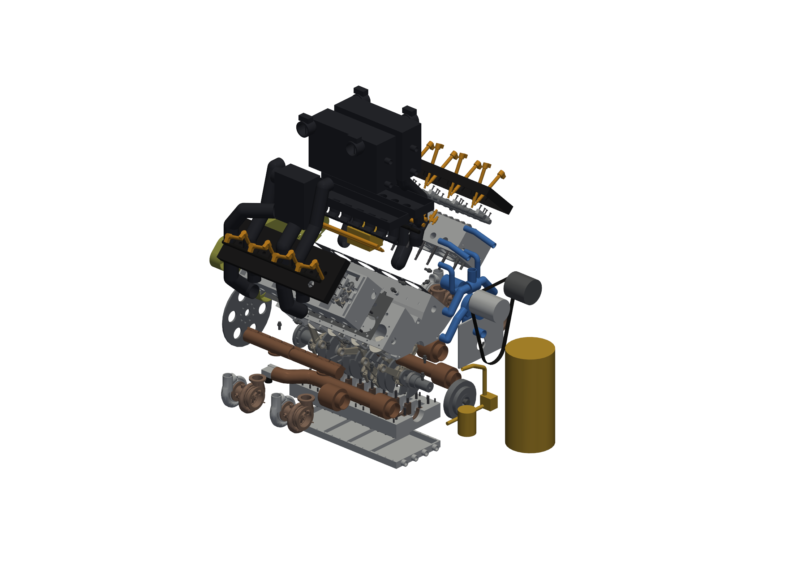<br><em>Exploded view.</em></p>


## 7. Engineering calculations (summary; full reports in `08_SIMULATIONS/analytical/`)

### 7.1 Performance and turbocharger matching

<p>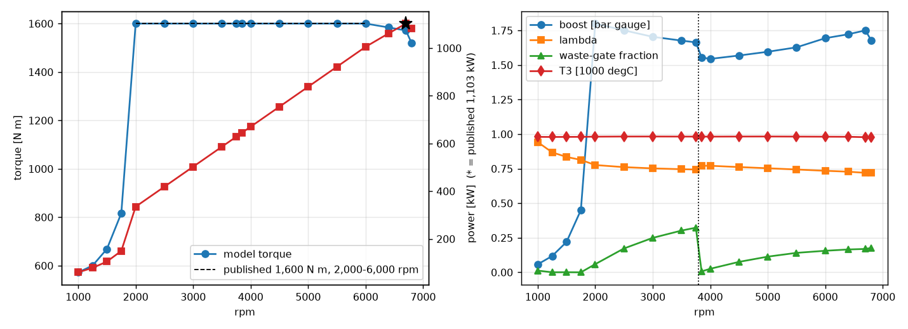<br><em>Full-load model results against the published torque and power.</em></p>


| Quantity at rated power | Model | Published |
|---|---|---|
| Boost pressure | 1.75 bar gauge | not published (about 1.85 bar quoted by secondary sources) |
| Air flow | 60,737 L/min | more than 60,000 L/min |
| Charge-air temperature drop | 115 K | as much as 130 K |
| Turbine inlet temperature | 978 degC (held by enrichment, lambda 0.72) | valve rated 980 degC |
| Peak cylinder pressure | 105 bar | not published |
| BSFC / fuel flow | 383 g/kWh / 567 L/h | - |

Torque and power are model targets, so they match by construction; the informative results are the boost, flows and temperatures and the
fact that the turbocharger power balance closes with four equal turbochargers sized at the change-over point. The same sizing gives full
torque with two turbochargers from about 2,000 rpm, consistent with the published plateau.

<p><br><em>Compressor operating line (surge/choke lines are representative shapes, not a measured map).</em></p>


### 7.2 Crank train
Rod force 50.9 kN compression at full load, 23.5 kN tension at 7300 rpm; main bearing peak 36.7 kN.
With fully balanced throws the free forces and moments would be 206 N and 39 N m at rated speed (higher orders only). First torsional mode 302 Hz (lumped model).

<p>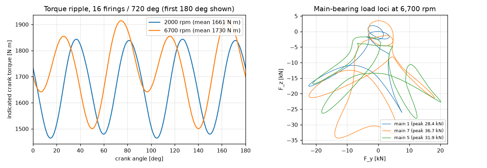<br><em>Torque ripple and main-bearing load loci.</em></p>


### 7.3 Thermal, lubrication, fuel
Fuel power 4983 kW; to HT coolant 341 kW (temperature rise 6.9 K at 800 L/min); to oil 138 kW;
charge-air coolers 146 kW at effectiveness 0.90. Oil demand 140 L/min, pump 175 L/min.

<p><br><em>Fuel-energy split at rated power (model).</em></p>


## 8. Simulation reports (finite elements)

Tools: gmsh tetrahedral meshes of the CAD solids, scikit-fem linear elasticity (P2 unless noted) and steady conduction (P1).
Peak values at re-entrant corners and at fixed boundaries are mesh-dependent; the 99.9th-percentile element stress is reported next to the peak.

| Case | Load case | Mesh | Results | Boundary conditions |
|---|---|---|---|---|
| cylinder block slice, cylinder 3 | gas pressure | 115879 tets, gamma min 0.01 | vm max MPa = 185; vm p999 MPa = 123; max displacement mm = 0.164 | 100 mm slice centred on cylinder 3 (contains its complete bore wall ring); crank-axis split plane fixed; the two cut faces (x = cyl. 3 +/- 50 mm) are symmetry planes (axial displacement fixed); design pressure on the upp |
| cylinder block slice, cylinder 3 | thermal | 115879 tets, gamma min 0.01 | T max C = 188; T bore max C = 188; T bore mean C = 125 | 100 mm slice centred on cylinder 3 (contains its complete bore wall ring); crank-axis split plane fixed; the two cut faces (x = cyl. 3 +/- 50 mm) are symmetry planes (axial displacement fixed); design pressure on the upp |
| cylinder block slice, cylinder 3 | thermal expansion | 115879 tets, gamma min 0.01 | bore radial growth mean um = 57.3; bore out of round um = 511 | 100 mm slice centred on cylinder 3 (contains its complete bore wall ring); crank-axis split plane fixed; the two cut faces (x = cyl. 3 +/- 50 mm) are symmetry planes (axial displacement fixed); design pressure on the upp NOTE: thermal growth with the same supports as the gas case (split plane fixed, cut faces symmetric); includes bending of the bank, so out-of-round is an upper bound |
| crank throw 3 in bending | single load case | 86290 tets, gamma min 0.10 | vm max MPa = 155; vm p999 MPa = 126; pin deflection mm = 0.0159; factor on p999 = 8.27 | both main-journal surfaces fully fixed (stiffer than real bearings -> fillet stress over-predicted); load on the central part of the pin; pulsating load, alternating stress = half the peak |
| cylinder head slice, cylinder position 3 (thermal) | single load case | 57160 tets, gamma min 0.00 | T max C = 336; T valve bridge max C = 220; T valve bridge mean C = 156; T roof mean C = 144; energy balance error pct = 2.92e-12 | cycle-mean chamber heat of one cylinder: roof area at the 1-D roof flux, the valve-head share through the seat-insert pockets; convection on all water-jacket walls inside the slice; port gas-side heat input (exhaust port NOTE: The slice faces (x = position 3 +/- 36.5 mm) cut through the outer intake-valve seat pockets, leaving thin adiabatic slivers; T_max and the gas-side 99th percentile are dominated by these slivers and are slice artefacts. Representative results: valve-bridge maximum and mean, roof mean. |
| main bearing cover (cast-in insert) | single load case | 10763 tets, gamma min 0.24 | vm max MPa = 88.7; vm p999 MPa = 74.5; bore deflection mm = 0.0203; yield factor on p999 = 4.97; peak bearing pressure MPa = 28 | bolt-hole surfaces fixed; support from the surrounding aluminium bedplate neglected (conservative) |
| piston | gas pressure | 81998 tets, gamma min 0.00 | vm max MPa = 182; vm p999 MPa = 105; crown deflection mm = 0.09; peak bearing pressure MPa = 85.3; T at vm max C = 248 | gas and gas + thermal: design gas pressure on all chamber-side surfaces above the top ring (crown, valve pockets, top land; ring-groove and second-land pressures neglected); pin reaction as a cosine bearing pressure on t |
| piston | thermal | 81998 tets, gamma min 0.00 | T max C = 431; T crown mean C = 380; T top ring groove C = 268; energy balance error pct = 2.27e-12 | gas and gas + thermal: design gas pressure on all chamber-side surfaces above the top ring (crown, valve pockets, top land; ring-groove and second-land pressures neglected); pin reaction as a cosine bearing pressure on t |
| piston | gas plus thermal | 81998 tets, gamma min 0.00 | vm max MPa = 285; vm p999 MPa = 138; max displacement mm = 0.39; T at vm max C = 248 | gas and gas + thermal: design gas pressure on all chamber-side surfaces above the top ring (crown, valve pockets, top land; ring-groove and second-land pressures neglected); pin reaction as a cosine bearing pressure on t |
| piston | fatigue estimate | 81998 tets, gamma min 0.00 | factor = 2.09; sigma a MPa = 52.7 | gas and gas + thermal: design gas pressure on all chamber-side surfaces above the top ring (crown, valve pockets, top land; ring-groove and second-land pressures neglected); pin reaction as a cosine bearing pressure on t NOTE: gas load from zero to the design pressure every cycle: alternating stress = half the 99.9th-percentile gas-case stress, against the room-temperature fatigue limit (no mean-stress or temperature correction - the hot strength at the boss and ring belt is lower) |
| connecting rod | compression design gas force | 16899 tets, gamma min 0.02 | vm max MPa = 391; vm p999 MPa = 357; yield factor on p999 = 2.47; max axial displacement mm = 0.278; peak bearing pressure MPa = 159 | big-end bore half fixed (loaded half); cosine bearing pressure on the loaded half of the small-end bore; no bolt preload, no contact |
| connecting rod | tension overspeed inertia | 16899 tets, gamma min 0.02 | vm max MPa = 592; vm p999 MPa = 489; yield factor on p999 = 1.8; max axial displacement mm = 0.475; peak bearing pressure MPa = 59.5 | big-end bore half fixed (loaded half); cosine bearing pressure on the loaded half of the small-end bore; no bolt preload, no contact |
| connecting rod | fatigue estimate | 16899 tets, gamma min 0.02 | factor = 1.18; sigma a MPa = 423 | big-end bore half fixed (loaded half); cosine bearing pressure on the loaded half of the small-end bore; no bolt preload, no contact NOTE: alternating stress taken as half the sum of the two p99.9 stresses (conservative, locations differ) |


<p><br><em>Connecting rod, design gas force: von Mises stress.</em></p>


<p>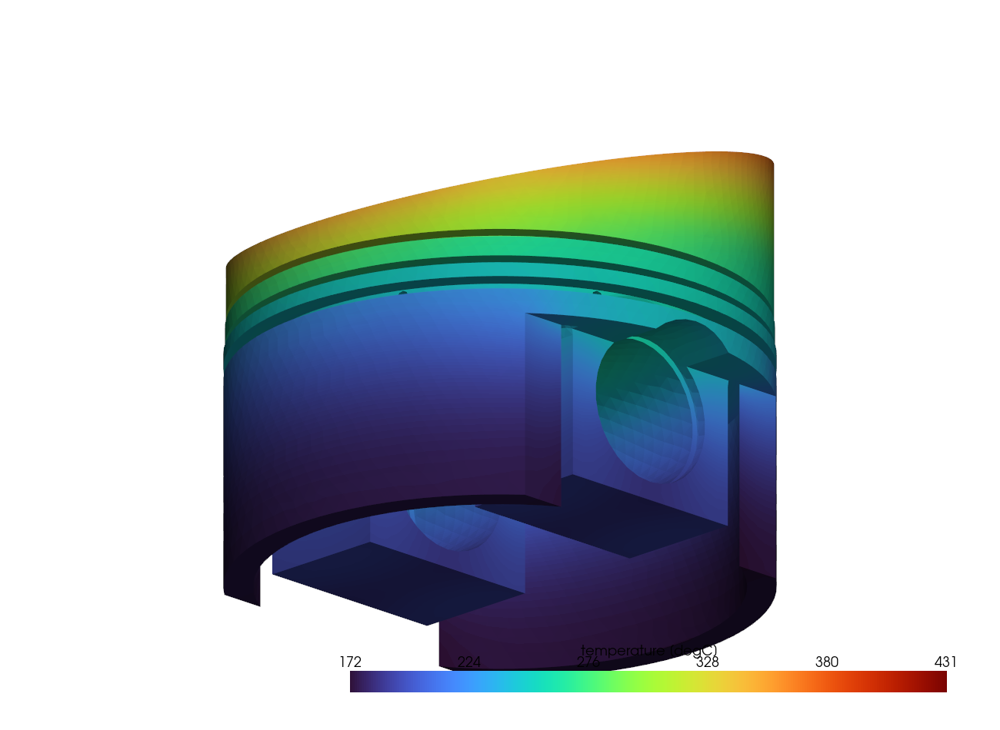<br><em>Piston steady temperature field.</em></p>


<p><br><em>Crank throw 3 in bending: von Mises stress.</em></p>


<p>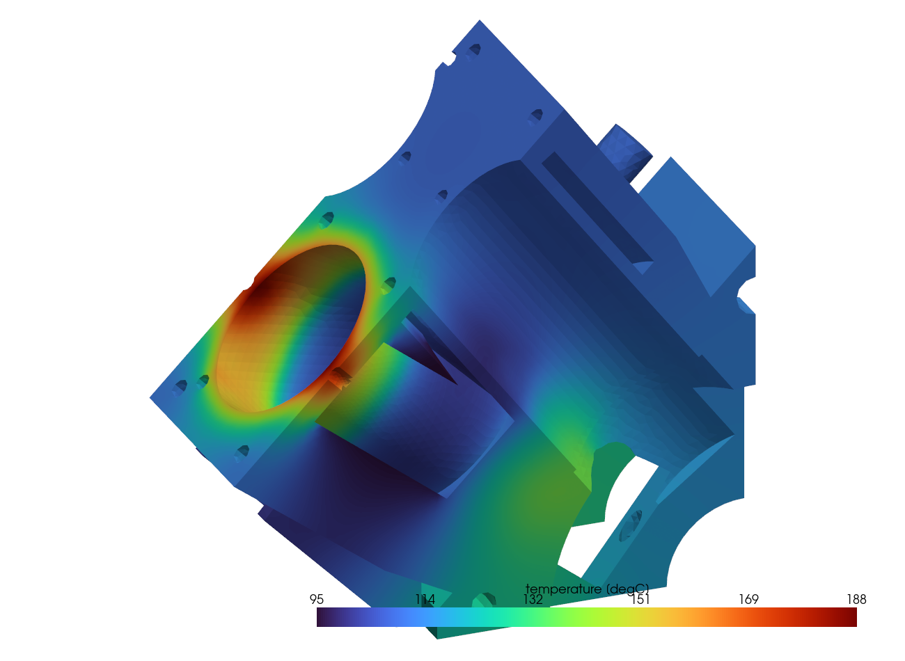<br><em>Cylinder-block slice: temperature field.</em></p>


<p><br><em>Cylinder-head slice: temperature field.</em></p>


### Findings from the FE results

- **cylinder block slice, cylinder 3:** thermal bore distortion up to 511 um (upper bound from a slice with a rigid base; rings typically tolerate a few tens of um) -> bore distortion needs a full-block thermo-mechanical analysis with head clamp load before the liner/jacket design can be accepted.
- **cylinder head slice, cylinder position 3 (thermal):** mesh has 1043 poorly shaped elements (gamma < 0.1); local peaks are unreliable.
- **cylinder head slice, cylinder position 3 (thermal):** valve-bridge temperature up to 220 degC (mean 156 degC), roof mean 144 degC - within the ~250 degC guide limit for cast Al-Si heads. The reported T max (336 degC) is a slice artefact (see note). Exhaust-port heat input was not applied, so exhaust-side temperatures are low.
- **piston:** mesh has 56 poorly shaped elements (gamma < 0.1); local peaks are unreliable.
- **piston - gas pressure:** peak 182 MPa (99.9th percentile 105 MPa) at |x|, |y|, z = 11.8, 18.5, 10.9 mm (pin axis along x, z up from the pin centre) - the corner where the end of the under-crown slot meets the cavity wall and the end of the R3 boss fillet. The concept CAD leaves this corner unradiused, so the peak there depends on the mesh; detail design radiuses it and re-checks. The 99.9th percentile is the basis of the fatigue estimate.
- **piston:** top ring groove 268 degC (within the ~280 degC guide) but crown up to 431 degC, mean 380 degC, at rated power with the estimated oil-side film coefficients (sensitivity - gallery 1,500 W/m2K: crown max 470 / groove 303 degC; gallery 4,000 W/m2K: crown max 396 / groove 235 degC; under-crown 1,000 W/m2K: crown max 411 / groove 254 degC; gallery 4,000 + under-crown 1,000 W/m2K: crown max 381 / groove 226 degC). The crown centre stays above the ~350 degC guide for forged Al-Si pistons in every case studied -> open item: confirm the piston heat load (cycle model, Woschni x 2 calibration) and the gallery cooling by test; if confirmed, stronger cooling (higher jet flow, under-crown spray) or a steel piston is needed.
- **piston - gas + thermal:** linear-elastic peak 285 MPa (99.9th percentile 138 MPa) at about 248 degC metal temperature. The yield (315 MPa) and fatigue (110 MPa) values used are room-temperature values; forged Al-Si piston alloys lose a large part of their strength above ~200 degC, so the pin boss and ring belt need a temperature-dependent elastic-plastic and fatigue analysis with a deformable pin (pin bending and bore contact) before release.
- **piston - top land:** radial growth up to 0.33 mm at rated power against 0.43 mm cold radial clearance (D-040 land relief) and 57 um mean bore growth (block FE) -> about 0.16 mm hot clearance at the tightest point - adequate for the concept; the piston / liner thermal match is a detail-design check.

Limitations of the FE work: linear elastic, no contact, no bolt preload, no bearing films, simplified supports, slices instead of the complete
castings, cycle-mean thermal loads from the 0-D model, no fatigue solver (factors are simple ratios against handbook limits).

## 9. Validation results

- **Compression ratio from CAD volumes:** cyl 1: 9.00 (V_tdc 62.4 cm3), cyl 2: 9.00 (V_tdc 62.4 cm3); target 9.0.
- **Firing intervals:** 45.000 deg for all 16 cylinders (numerical TDC search).
- **Interference check:** 4850 static pairs clear, 2500 intentional contacts (threads, press fits, seats), 35 static clash pairs;
  kinematic sweep over 12 crank angles: 11853 pair checks clear, 4 clash pairs; boolean errors 94 / 0.

| Check | Part A | Part B | Occurrences | Max overlap [mm3] |
|---|---|---|---|---|
| static | W16-09-air_duct_B-L1 | W16-09-charge_pipe_B-L1 | 1 | 1488 |
| static | W16-09-air_duct_B-L2 | W16-09-charge_pipe_B-L2 | 1 | 1487 |
| static | W16-09-air_duct_A-L1 | W16-10-downpipe_B-L1 | 1 | 840.7 |
| static | W16-09-air_duct_A-L2 | W16-10-downpipe_B-L2 | 1 | 838.5 |
| static | W16-07-008~10 | W16-07-010 | 1 | 598.7 |
| static | W16-07-008~03 | W16-07-010 | 1 | 520.9 |
| static | W16-07-008~08 | W16-07-010 | 1 | 468.8 |
| static | W16-07-008~05 | W16-07-010 | 1 | 468.8 |
| static | W16-07-008~09 | W16-07-010 | 1 | 223.2 |
| static | W16-13-pipe_pump_to_block_2 | W16-14-front_cover | 1 | 221.1 |
| static | W16-13-pipe_pump_to_block_1 | W16-14-front_cover | 1 | 221.1 |
| static | W16-07-008~04 | W16-07-010 | 1 | 175.7 |
| static | W16-07-008~06 | W16-07-009 | 1 | 149.6 |
| static | W16-07-008~04 | W16-07-009 | 1 | 149.6 |
| static | W16-08-003 | W16-10-downpipe_B-L1 | 1 | 137.9 |
| static | W16-08-004 | W16-10-downpipe_B-L2 | 1 | 137.9 |
| static | W16-02-001 | W16-11-rail_P-L1 | 1 | 118.5 |
| static | W16-02-002 | W16-11-rail_P-L2 | 1 | 118.5 |
| static | W16-08-003 | W16-10-shutoff_valve-L1 | 1 | 115.7 |
| static | W16-08-004 | W16-10-shutoff_valve-L2 | 1 | 115.7 |
| static | W16-01-001 | W16-14-mount_bracket_R | 1 | 97.63 |
| static | W16-01-001 | W16-14-mount_bracket_L | 1 | 97.63 |
| static | W16-07-006 | W16-07-010 | 33 | 96.28 |
| static | W16-11-003~0 | W16-11-003~1 | 16 | 82.43 |
| static | W16-07-008~06 | W16-07-010 | 1 | 51.93 |
| kinematic | W16-04-003 | W16-05-001 | 96 | 26.53 |
| kinematic | W16-06-011 | W16-06-013 | 2 | 1.26 |
| kinematic | W16-06-009 | W16-06-013 | 2 | 0.72 |
| kinematic | W16-02-001 | W16-06-001 | 2 | 0.67 |

These remaining overlaps are packaging errors of this concept model and are listed as open work; they are not hidden.
- **Piston-to-valve clearance, spring loads, transverse head clearances:** `08_SIMULATIONS/analytical/03_valvetrain.md`.
- **Comparison with published targets:** section 7.1.

## 10. Acceptance criteria

| Criterion | Result | Evidence |
|---|---|---|
| All sixteen cylinders are represented | PASS | 16 bores in the block CAD; pistons x16 |
| Four cylinder banks (rows) correctly organised | PASS | two VR8 banks at 90 deg, each with two rows at 15 deg; firing intervals 45.000 deg (layout check) |
| Engine architecture mechanically coherent | PARTIAL - valve-train clashes remain | interference check: 35 static and 4 kinematic clash pairs remain (listed in the report) |
| Displacement consistent with bore and stroke | PASS | 7992.92 cm3 vs 7,993 cm3 published |
| All sixteen piston assemblies modelled | PASS | pistons 16, pins 16, rings 48 |
| Shared crankshaft modelled | PASS | one-piece crank, 8 pins, 9 mains, distributed counterweights |
| All connecting rods represented | PASS | rods x16 with caps, shells, bushes, bolts |
| Cylinder heads and the 64-valve system modelled | PASS | 64 valves, 64 springs/retainers/followers/support elements, 4 camshafts; **two head castings serve the four rows** (documented architecture, decision D-003) |
| Four turbochargers modelled | PASS | 2 RH + 2 LH units with housings, wheels, bearing housing, actuator |
| Sequential turbocharging flow architecture documented | PASS | diagram + animation + matching calculation |
| Intake and exhaust systems connected | PASS | manifolds, coolers, charge pipes, logs, cross-over, down-pipes modelled per bank |
| Fuel injection and ignition represented | PASS | 32 injectors, 4 rails, 16 plugs, 16 coils; EMS architecture diagram |
| Lubrication and cooling circuits modelled | PASS | galleries and jackets are real passages in block/heads; external circuit parts and 1-D flow calculations |
| Major mechanical interfaces validated | PARTIAL | CAD interference check (static all-pairs + 12 crank angles); CAD compression ratio 9.00, 9.00 |
| Parametric CAD files editable | PASS | geometry is generated from `src/w16/params.py`; BREP per part in `05_COMPONENT_CAD/` |
| STEP exports generated | PASS | 166 component STEP files; master assembly 186.59 MB; 15 sub-assemblies |
| STL and 3MF exports generated where supported | PASS | 166 STL, 159 3MF component files |
| Exploded assembly documentation complete | PASS | exploded views + hierarchy |
| Engineering drawings available | PASS | 9 sheets (PDF/SVG/PNG) |
| Simulation evidence documented | PASS | FE cases run: block, crank, head, insert, piston, rod; not run: none; 0-D/1-D models in `08_SIMULATIONS/analytical`. No 3-D CFD. |
| BOM complete | PASS | 151 part numbers (modelled content only) |
| Final technical report produced | see file | `12_FINAL_REPORT/` (Markdown + PDF) |
| Deliverables organised in the structured directory | PASS | folders 01-14 + 00_PROJECT_CONTROL + src |

## 11. Bill of materials and procurement

151 part numbers; see `10_BOM_AND_PROCUREMENT/BOM.md` / `BOM.csv`. No costs are given because no reliable price source exists.

## 12. Materials and manufacturing

See `11_MANUFACTURING_DOCUMENTATION/MANUFACTURING_SPEC.md` (materials, processes, critical dimensions, tolerance classes, inspection, assembly sequence, maintenance).

## 13. Drawings, exports, animations

- Drawings: `07_ENGINEERING_DRAWINGS/` (9 PDF sheets, also SVG/PNG).
- STEP: `13_EXPORTS_STEP/` (master assembly + components); sub-assemblies in `06_ASSEMBLIES/step/`. STL / 3MF: `14_EXPORTS_STL_3MF/`.
- Animations: `09_ANIMATIONS/` (7 GIF, 7 MP4).

## 14. Known engineering limitations

1. No manufacturer geometry: every internal dimension is a reconstruction. The model shows that the public data are mutually consistent; it does not reproduce the real parts.
2. No 3-D CFD of any kind (ports, plenum, coolant jacket, combustion). Flow results are 0-D / 1-D.
3. The cycle model is uncalibrated; enrichment, boost and temperatures are plausible estimates. Knock is not modelled.
4. Turbomachinery is sized, not designed: wheels and volutes are representative shapes; there are no compressor or turbine maps.
5. FE is linear and local (see section 8). No fatigue, no bearing elasto-hydrodynamics, no valve-train dynamics, no crank 3-D torsional/bending model, no thermal-mechanical head analysis with valve-bridge detail.
6. Purchased units (injectors, coils, sensors, pumps, alternator, phasers, tensioners) are envelopes. Seals, O-rings, dowels, clips, brackets, most small fasteners, hoses and the detailed harness are not modelled.
7. Castings have no draft, fillets or wall-thickness optimisation; mass is therefore indicative.
8. Tolerances are classes, not a stack-up. Drawings are layout drawings.
9. **Valve-train clashes remain** after the D-039 revision: W16-02-001 / W16-06-001, W16-06-009 / W16-06-013, W16-06-011 / W16-06-013. Other remaining CAD overlaps are listed in section 9.
10. The engine-management description is an architecture, not software.

## 15. Future development recommendations

1. Resolve the listed interferences and add draft/fillets to castings; then repeat the mass and FE work on full castings.
2. 1-D gas-dynamics model (GT-Power class) with real turbocharger maps; then 3-D CFD of ports, plenum distribution and water jackets.
3. Elasto-hydrodynamic bearing analysis and a flexible multi-body crank and valve-train simulation; damper tuning.
4. Thermo-mechanical fatigue analysis of head and manifolds; piston secondary motion and ring-pack analysis.
5. Tolerance stack-ups for the chamber volume (CR scatter), valve train and timing drive.
6. Supplier engagement for turbochargers, bearings and valve train; replace envelopes by supplier CAD.
7. Prototype sequence: single-bank VR8 test rig for combustion and cooling development before the full W16.

## 16. Reproducing the package

```
set PYTHONPATH=src
.venv\Scripts\python -m w16.reports            analytical package
.venv\Scripts\python -m w16.cad.assembly       CAD build + summary
.venv\Scripts\python -m w16.cad.export all     exports, hierarchy, validation
.venv\Scripts\python -m w16.cad.export interference
.venv\Scripts\python -m w16.cad.render         views and animations
.venv\Scripts\python -m w16.cad.drawings       drawings
.venv\Scripts\python -m w16.sim.fea            finite-element cases
.venv\Scripts\python -m w16.diagrams           schematics
.venv\Scripts\python -m w16.docs               BOM, manufacturing spec, this report
```
